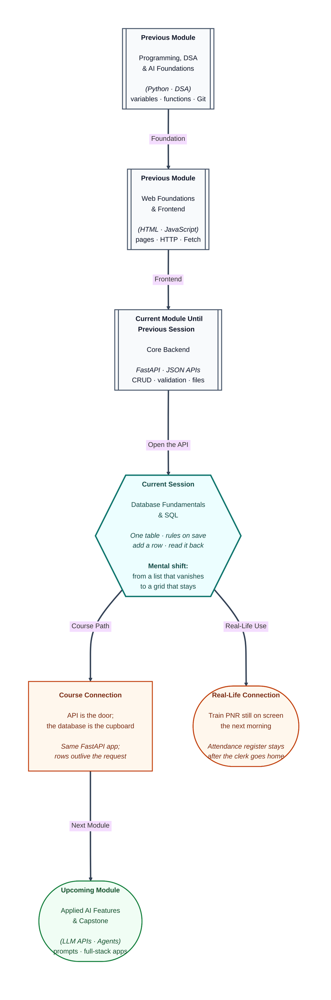

# Pre-read: Database Fundamentals & SQL (Part I)

## Context of This Session in the Course

---

You book a train ticket tonight. Tomorrow morning the same PNR is still on the screen.

The phone did not memorise that ticket. A record was written into an organised store, then read back when you asked again. College attendance works the same way. The clerk goes home. The register stays in the cupboard. Your name is still on the page in the morning.

In the previous session you decided which pages may call your API, accepted an uploaded file, and let a small task run after the receipt was stamped. Those tools move messages and documents. They do not give you a grid of records that stays organised after the program stops.

**What if every student lived only in the clerk's memory?** Close the counter and the list is gone. **What if four hundred admission forms were loose papers**, with no rule that an email may appear only once, and no rule that marks must sit between 0 and 100? Finding names and cities would mean reading every sheet by hand.

A list inside a running program has the same weakness. Stop the program and the list vanishes. An uploaded file keeps the bytes, but it has no columns and no uniqueness rule. A spreadsheet on one laptop cannot answer when a student checks a result at midnight.

This session adds the cupboard behind the door. You will see why a backend uses a **relational database**, how to **design one table**, how to **add a row** the rules accept, and how to **read those rows** back.

---

## The blank form and the filled form

Picture one admission form that the office reprints for every student. The **blank form** is the design. Each **filled form** is one student. The roll number never belongs to two people. If another student is also named Asha, the roll number still points at one line.

- A **table** is one grid for one kind of fact. The student list is not the whole college.
- A **column** is one labelled box, repeated down the page: name, email, city, marks.
- A **row** (a **record**) is one filled form. Asha Rao is one row. Rahul Mehta is another.
- The **schema** is the blank form and its rules, before anyone has written a name.

A box left untouched is not the same as zero, and not the same as a typed empty word. **NULL** means no value was stored. Marks of 0 mean zero marks.

Each box also has a **data type**: numbers only, or words only. Marks are a whole number. A name is text. A price such as 249.50 needs an exact number that can include paise. The store refuses the word "eighty" in a marks box.

| Where the facts live | Still there after a restart? | Can the store insist this email appears once? |
| --- | --- | --- |
| A list in a running program | No | Only if your own code remembers every check |
| An uploaded file or a plain text file | Yes | No built-in columns or uniqueness |
| A relational database | Yes | Yes. You declare the rules on the table |

The API stays the door. The database is the cupboard behind the door. One listens for visits. The other keeps the grids.

---

## The roll number and the printed rules

Two students must never share a roll number. That identity is the **primary key**. Here it is a column called id. Even if two people share a name, id 1 is one row and id 2 is another.

A **constraint** is a printed instruction the clerk will not ignore. The database refuses the save. It does not quietly keep a broken line.

- **Primary key** — unique identity. A second row may not reuse id 1.
- **NOT NULL** — the box must be filled. A student row without a name is refused.
- **UNIQUE** — the same email cannot appear on two rows. The same person-name may. The email may not.
- **DEFAULT** — the value used when that box is left out. Omit city, and the store can write "Not given."
- **CHECK** — a condition the new value must pass. Marks of 120 are refused when the rule allows only 0 to 100.

You design these rules before you add people. Name and email are required. Email cannot repeat. Marks must be a whole number from 0 to 100. Leave the identity out, and the database stamps the next roll number. Type an identity that is already stored, and the primary key rejects that row.

A refused line does not leave a half-written student. The older, valid rows stay.

---

## A formal sentence, not a free essay

**SQL** (Structured Query Language) is how you talk to a relational database. In simple words: short, formal sentences. Make this grid. Add this line. Show these columns.

Think of a bank withdrawal slip. The printed headings stay fixed. You fill the boxes. You do not rewrite the form as an essay.

**PostgreSQL** is the software that owns the cupboard. It stores the grids and checks the rules. **Supabase** is the login that opens that cupboard in the browser. You sign in, open one project, and type in the **SQL Editor**: a text box, a Run button, and an answer grid underneath.

One complete sentence is a **statement**. Words such as create, insert, and select are **keywords** — printed words on the form. Names you invent, such as students or email, are your own.

You practise while you are signed in. The database password protects the project. It is not a column, and it does not belong inside the sentence. The **Table Editor** shows the same grid as a sheet, so you can confirm a row landed. The formal asks still belong in the SQL Editor.

---

## Add a line, then ask to read it

**INSERT** writes a row. You name the boxes you are filling, then give the values in that same order. Text is written as words. A number is written as a number. Mix up the order and a city can land in the marks box.

Leave city out on purpose, and the default can run. Store "nothing" on purpose, and you get NULL, which is different from the default text. You can add one student, or several, in one sentence.

An empty-looking screen after a successful insert does not mean the row is missing. Writing and reading are different jobs.

**SELECT** is the read. It does not remove rows, and it does not change marks. The answer is a **result set**: a photocopy of the columns you asked for, not a new register. Ask for every column, or only name and marks. The order you ask is the order you receive.

A temporary heading on that photocopy is an **alias**. The stored column can still be full name while today's notice prints "student name." The cupboard is unchanged.

You can arrange the **answer** — highest marks first — keep only the first few lines of that arranged answer, or ask for each different city once. None of this moves the stored rows. Fewer columns is not fewer rows. Showing only name and city still lists every student.

Choosing only the rows that match a condition, such as "only Pune," is a later skill. Today you design the grid, add lines the rules accept, and read what was stored.

The same habits fit a second grid you will sketch on paper: a small catalogue of books. One row means one book. Title and author are required. Price cannot be negative. If copies are omitted, the store keeps zero.

The SQL Editor is the practice counter. When a real request arrives, the API you already built can send the same kind of "add a row" or "read these columns" and place the rows in a reply. In the editor you type each value yourself. A program that later sends a user's name should keep the sentence **fixed** and pass the name beside it, the way the amount goes in the box on a printed slip.

---

In this pre-read, you'll discover:

- Why a backend needs a **relational database** when a list in memory and a loose file are not enough.
- How a **table**, a **row**, a **column**, a **primary key**, and **constraints** fit together like a form and its printed rules.
- What it means to **add a record** the rules accept, and why a repeated email or an impossible mark is refused.
- How **reading** columns, renaming a heading, and sorting an answer leave the stored register in place.

---

## What's Next

After the session, you will be able to:

- Explain why the API is the door and the database is the cupboard that still holds rows after a restart.
- Design a single table on paper: identity, required fields, a value that cannot repeat, a default, and a range check.
- Add students the rules accept, and predict which inserts the database will refuse.
- Read chosen columns, give the answer a temporary heading, sort it, and show each different city once.

---

## Think About These Before the Session

Bring these to class:

- A program keeps students in a list, then the program stops. Are those students still there in the morning? What about a train PNR?
- Two rows are both named Asha Rao. What makes them two different students, and what must never be shared?
- Rahul's form leaves the city box out. Should the store keep "nothing," or a printed default such as "Not given"?
- You ask only for names and marks, highest marks first, and only the top two lines of that answer. Did any stored row change?

If you can already open an API door, stamp a visit, and move a file, you are ready to put a **register** behind that door — and to let the register, not your memory, keep the rules.
