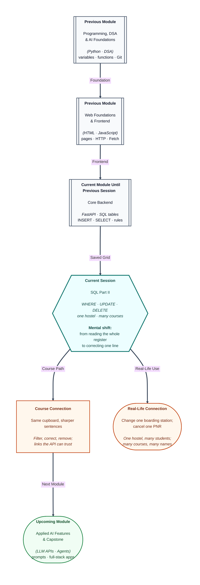

# Pre-read: Database Fundamentals & SQL (Part II)

## Context of This Session in the Course

---

You book a train ticket, then later change the boarding station. The PNR stays. One line in the register is corrected. The other passengers are not rewritten.

Sometimes the trip is cancelled. That one booking is removed. Everyone else stays on the list.

In the previous session you designed one student grid, added rows, and read them back. Every read returned the **whole** list, because the sentence had no test. A class list, a search box, and a “my marks” page almost never want every row.

**What if fixing Asha’s marks meant copying the entire register by hand?** **What if cancelling one practice booking threw away the register itself?** **What if “students in Pune” and “students in every city” were the same answer?**

That is the gap this session closes. You will **choose** rows, **change** a saved value, **remove** one row while the grid stays, and **connect** a second list to the students you already have.

---

## The clerk reads only some lines

A **WHERE** clause is the test written after the table name. In simple words: a yes-or-no question asked once per row. Rows that fail the test stay in the cupboard. They simply do not appear in **this** answer.

Think of the clerk reading out only the Pune lines. Lucknow is still in the register.

The sign in the middle of the test is a **comparison**:

- **Same as** — city is exactly Pune. Asha matches. Meera does not.
- **Different from** — everyone who is not Pune.
- **Greater than**, or **at least** — marks above 80, or marks of 88 and above.
- **Less than** — marks under 70.

**AND** means both tests must pass. Pune **and** marks of at least 80 is a shorter list. **OR** means either test may pass. Chennai **or** Lucknow is a wider list.

Text in a test must match the stored spelling. `Pune` and `pune` are different. An empty answer does not mean the table is broken. It often means the test did not match the ink already on the page.

An empty box is a special case. **NULL** means no value was stored. Asking “is city the same as nothing?” does not find those rows. The proper question is “is this box empty?” Rahul’s city in the sample is the words **Not given**. That is a real value, so he is found by “same as Not given,” and he is not found by “is this box empty?”

WHERE filters the **photocopy**. It does not delete the other students.

---

## A correction slip for one line

**INSERT** adds a new row. It does not edit Asha’s marks. **UPDATE** writes a new value into a row that is already there. A correction slip, not a fresh admission form.

The safe shape has three parts: which table, which new values, which rows. Change marks to 90 **only** where the identity is Asha’s. Her email and her roll number stay. Rahul, Meera, and Imran are untouched.

You can correct two boxes on the same line, such as city and marks together. The rules from the previous session still apply. Marks of 150 are refused, and the old marks stay. A second copy of Asha’s email is refused, and the old email stays. A failed correction does not half-save the row.

The danger is a correction with **no test**. “Set every city to Pune” really does rewrite every city. The editor will not ask “are you sure?” The condition is your safety. Before you trust a change, read with the same test and confirm you see only the row you meant.

---

## Draw a line through one booking

**DROP TABLE** throws away the whole grid, design and rows together. **DELETE** removes rows and leaves the table on the shelf, ready for the next student.

Always name the rows. “Delete from students” with no test removes **every** student and keeps the columns. That is a different job from cancelling one practice booking.

A careful cancel has two steps in your mind. First, add a temporary practice student. Then remove only the row whose email is that practice address. The other four students remain. The identity numbers do not go backwards. The next new student does not reuse the number you just freed.

A test can match more rows than you think. “Marks under 90” might remove two people at once. Read with that same test **before** you delete. If the read shows one row, the delete touches that one row.

Deleting rows does not delete the project, the editor, or the blank form. If the table is emptied by mistake, the design is still there and the sample list can be rebuilt.

---

## One hostel, many students

A student list by itself cannot say “these two people share one hostel” without repeating the hostel’s full story on every line.

A second table holds each hostel **once**. Each student stores that hostel’s identity number. That link is a **one-to-many** relationship. In simple words: one hostel, many students. Each student points at only one hostel.

Pune House can have Asha and Rahul. Each of them has a single hostel number on their own row. Guest House can exist with nobody in it yet.

The number they store is a **foreign key**: a roll number that must already exist in the other register. Hostel 1 is allowed only because hostel 1 exists. Hostel 99 is refused, and the old number stays.

You can ask “who points at Pune House?” and get Asha and Rahul. That answer shows their hostel **number**, not the words “Pune House.” Those words live in the hostel list. Putting the building’s name on the same line as the student is a later step. Today you design the link and read one table at a time.

You also cannot throw away Pune House while Asha and Rahul still point at it. The database will not leave a student pointing at a building that no longer exists. Guest House, which nobody uses, can be removed. To remove a busy hostel, move those students first.

---

## A sheet of pairs

One hostel fits in a single box on the student form. A course list does not.

Asha can take two courses. One course can have two students. A single column cannot hold both course numbers. That is a **many-to-many** relationship: many students, many courses.

The pairs live in a third grid, a **link table**. Each line says “this student, this course,” using identity numbers, not names. Asha in Databases is one line. Asha in Python is another. Meera in Databases is a third. Databases now has two students. Asha has two courses.

The same pair cannot be stored twice. Meera cannot be enrolled in Databases a second time. Removing the line “Asha leaves Python” deletes that **pair** only. Asha remains a student. Python remains a course. Her Databases line remains.

Ask “which course numbers does Asha have?” and you see numbers. Ask “which student numbers are in Databases?” and you see numbers. The course title still lives in the course list.

---

## The same test, three jobs

**INSERT** has no WHERE. The row is not there yet to test. On the way in, a foreign key still checks that the hostel or the course already exists.

**SELECT**, **UPDATE**, and **DELETE** use WHERE whenever you mean “only these rows.”

| Action | What it does | What the test does |
| --- | --- | --- |
| Add | Puts a new row in | No test on existing rows. The link must already be real |
| Read | Photocopies matching rows | The full table stays in the cupboard |
| Correct | Changes matching rows | Other rows keep their old values |
| Remove | Takes matching rows out | The blank form stays on the shelf |

A backend that edits “this student” must send that student’s identity in the test. Editing every row is a different, dangerous sentence. Use the same condition you would trust in a read. If that read shows one person, the matching correction or removal touches that one person.

---

In this pre-read, you'll discover:

- How a **filter** shows only the rows that pass a test, without deleting the rest.
- How a **correction** changes a value already stored, and why a missing test rewrites the whole list.
- How **removing one row** is different from throwing away the table.
- How **one hostel, many students** and **many courses, many students** are stored so the link cannot point at a missing record.

---

## What's Next

After the session, you will be able to:

- Say which students a test should return, including an empty box versus the words “Not given.”
- Correct one student’s marks or city, and predict which corrections the old rules will refuse.
- Remove one practice row and explain why the table, and the other students, are still there.
- Point at a hostel number on a student, and at a pair in an enrolment list, and say which side is “one” and which side is “many.”

---

## Think About These Before the Session

Bring these to class:

- You ask for Pune only. Meera lives in Chennai. Is she deleted, or only missing from this answer?
- You set marks to 150 for Asha. What stays written on her line, and why?
- “Delete students” has no test. What is left on the shelf: nothing, or an empty register with the same boxes?
- Asha and Rahul both point at Pune House. Can that building be removed while they still point at it? What about a guest house nobody uses?

If you can already add a row and read the whole grid, you are ready to **choose one line**, correct it, cancel it, and connect it to a second list without breaking the cupboard.
