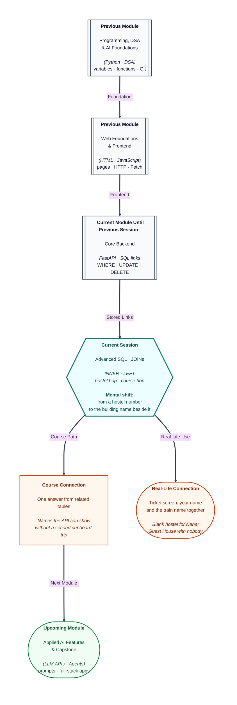

# Pre-read: Advanced SQL – JOINs

## Context of This Session in the Course

---

A train ticket on your phone shows your name and the train name on one screen. Those facts do not live in one box.

Your name sits on the booking. The train name sits on the train list. The screen brings the matching lines together.

In the previous session you filtered rows, corrected a saved value, and removed one row. You also stored links: a hostel number on the student, and a sheet of pairs that says “this student, this course.” A read of the student list could show hostel number 1. It could not show the words **Pune House** on that same line.

**What if the clerk had to match four hundred hostel numbers by eye?** **What if a student with no hostel vanished from every list, even the list that asks “who is still waiting for a room?”** **What if a guest house with nobody in it disappeared, just because no student points at it?**

This session teaches the **JOIN**: a rule that sticks a student line to the related line, so one answer carries both names. The stored tables stay as they are. The join only builds the photocopy.

---

## Two sheets, one matching number

Picture the exam office laying the student sheet beside the hostel sheet and drawing a line wherever the numbers agree.

A **JOIN** is that line, drawn by the database. **ON** is the instruction for which numbers to compare. In simple words: the student’s hostel number equals the hostel’s own identity. Match the roll number written on the form to the roll number on the other register. Do not match a person’s name to a building’s name, and do not match two unrelated identity columns just because both are called id.

Both sheets have a column named id. After a join, “id” alone is ambiguous. The sentence must say which sheet.

A wrong rule can look right by accident. Asha’s identity is 1, and Pune House’s identity is also 1. The real link is not “student identity equals hostel identity.” It is “the hostel number stored on the student equals the hostel’s identity.”

---

## Only the pairs that match

An **INNER JOIN** returns a row only when both sides have a partner. If either side has no match, that line is left out of the answer.

Think of a list of students who already have a hostel.

- Asha and Rahul each appear with Pune House. The building name is repeated because two students match it.
- Meera appears with Chennai House. Imran appears with Lucknow House.
- **Neha Shah** does not appear. Her hostel box is empty, so nothing matches.
- **Guest House** does not appear. It exists, and no student points at it.

The answer has one row per successful match, not one row per student and not one row per building.

A short nickname for a table, used only in this sentence, keeps the columns clear: sheet S for students, sheet H for hostels. The stored names do not change.

A filter can still sit on the finished answer. “Matches whose marks are at least 90” keeps Asha and Meera and drops Rahul and Imran from that photocopy only. Neha was already absent, because the inner join removed her before the marks test.

---

## Keep the list you refuse to lose

An inner join answers “who has a partner?” A warden also asks “who has no hostel yet?” Neha must appear, with a blank building name.

A **LEFT JOIN** keeps every row from the **left** table. The left table is the one you start from. The right table is the one you bring in. If the right side has no partner, those columns come back empty. That empty is **NULL** — no value — not the words “empty.”

Start from students, and all five names appear. The four allotted students look the same as in the inner join. Neha appears with a blank hostel. Guest House still does not appear, because it lives on the right, and this question did not promise to keep unmatched buildings.

Swap the question and you swap the sheets. Start from hostels, and every building appears, including Guest House with a blank student name. Pune House appears twice, once with Asha and once with Rahul.

To find only the people still waiting for a room, keep every student on the left, attach a hostel when the number matches, then keep the rows where the hostel side stayed empty. Neha is that row. An inner join plus “hostel side is empty” returns nothing, because Neha was thrown away before you could test the blank.

| Question | Which join | Who appears |
| --- | --- | --- |
| Students who already have a hostel | Inner join, students first | Asha, Rahul, Meera, Imran |
| Every student, hostel only if allotted | Left join, students first | Those four, plus Neha with a blank |
| Every hostel, student only if someone lives there | Left join, hostels first | All four buildings; Guest House with a blank name |

---

## Two hops to a course title

The enrolment sheet stores numbers, not names. The student name is on the student list. The course title is on the course list. One join is not enough. The title is a second hop away.

First match the student to a line on the enrolment sheet. Then match the course number on that line to the catalogue. Each hop has its own matching rule.

With an inner join through both hops:

- Asha appears **twice** — Databases and Python. Two courses become two result rows. She is not copied twice in the stored table.
- Rahul and Meera appear once, each with Databases. Imran appears once, with Python.
- Neha does not appear. She has no enrolment.
- **Aptitude** does not appear. Nobody enrolled, so no pair points at it.

A filter such as “title is Databases” keeps Asha, Rahul, and Meera. Imran is enrolled, but in Python, so he drops out of that answer only.

To keep every student, and attach a course only when they have one, use a left join for both hops. Asha still has two rows. Neha appears once, with a blank course name. Aptitude still stays hidden, because courses are on the right. Start from courses when the question is “which course has nobody?” Aptitude then appears with a blank student name.

---

## A filter can undo the blank

**ON** decides which right-hand row is allowed to stick. **WHERE** decides which finished rows you keep.

A test on the right-hand title, written as a final filter — “course name is Python” — throws away every blank. The sentence still says left join. It behaves like an inner join. Asha and Imran remain. Neha, Rahul, and Meera disappear, because their result rows do not carry the title Python.

Move that extra test into the matching rule when you want **every** student, with Python attached only if they take it. Asha and Imran show Python. The others show a blank course name. They are not deleted from the student list.

Use the final filter for tests on the left table, such as “city is Pune,” when you still want those left rows. Use the matching rule for tests that only choose which right-hand row to attach.

The join does not change the cupboard. Read the students again afterwards. Neha’s hostel box is still empty.

---

In this pre-read, you'll discover:

- Why related facts need a **join** when a hostel number is not the same as the building’s name.
- How an **inner join** keeps only pairs that match, and drops Neha and Guest House from that answer.
- How a **left join** keeps the list you start from, and leaves a blank where the other side has no partner.
- How a course title needs **two hops**, and how a final filter can accidentally throw away the blanks you meant to keep.

---

## What's Next

After the session, you will be able to:

- Say which column is the real link between students and hostels.
- Predict who appears in an inner join, and who appears only when the left list is protected.
- Place Guest House or Aptitude on the left when the question is “who has nobody?”
- Explain why Asha’s name can appear twice in an answer without being stored twice.
- Tell a matching rule apart from a final filter, so a left join does not quietly become an inner join.

---

## Think About These Before the Session

Bring these to class:

- Asha’s identity is 1, and Pune House’s identity is also 1. Is that the link, or is the link the hostel number written on Asha’s row?
- You want every student, including Neha. Which sheet must you start from, and what should the building column show for her?
- Guest House has no students. Which sheet do you start from if that building must still appear?
- You ask for Python with a left join, then filter “course name is Python.” Why do Rahul and Neha vanish even though the sentence said “left”?

If you can already store a hostel number and a sheet of course pairs, you are ready to **read across those links** and put the related name on the same line.
