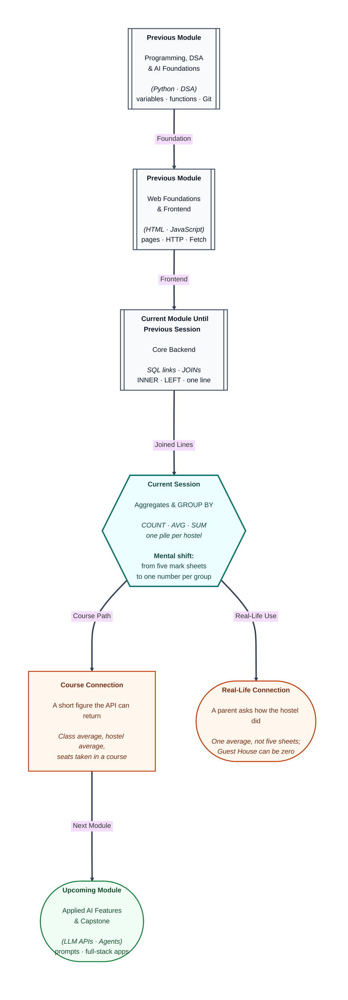

# Pre-read: Advanced SQL – Aggregate Functions & GROUP BY

## Context of This Session in the Course

---

A class teacher does not read every mark sheet aloud when a parent asks, “How did this hostel do?” The answer is one average, or one highest mark, not five separate lines.

A course office asks a different question: “How many students enrolled in Databases?” That answer is a count of seats taken, not the list of names.

In the previous session you placed a hostel name or a course title on the same line as a student. Asha appeared twice in the course result, once for each enrolment. Those were detail rows. Today you collapse detail rows into **one summary number per group**.

**What if you had to add four hundred marks by hand every time a parent called?** **What if “how many live in Pune House?” meant reading every name again?** **What if an empty guest house was counted as one student, just because a blank line existed on the answer sheet?**

The stored register does not change. The photocopy gets shorter.

---

## One figure for the whole class

An **aggregate function** reads many values and returns one value. In simple words: a calculator that looks down a column and gives back a single figure.

The sample class has five students. Marks are 90, 80, 91, 70, and 85.

- **COUNT** is a headcount. Five students are on the roll.
- **SUM** is the total. 90 + 80 + 91 + 70 + 85 = **416**.
- **AVG** is the average: the total divided by how many numbers were included. 416 ÷ 5 = **83.2**.
- **MIN** is the lowest mark. Imran’s **70**.
- **MAX** is the highest mark. Meera’s **91**.

Five students become **one answer row**, with several figures sitting side by side. The names are still stored. Ask for the marks again and you still see 90, 80, 91, 70, and 85.

Two headcounts are not the same question.

**COUNT of rows** includes everyone, so Neha is included. The result is 5. **COUNT of the hostel box** skips an empty box. Neha has no hostel, so that headcount is 4. They match only when every counted box is filled.

An average also ignores an empty number. Marks here are never empty, so Neha’s 85 stays in the class average. An empty hostel does not remove her marks.

---

## Sort the sheets into piles

One class average hides the hostel story. Pune House has two students. Lucknow House has one student, and that mark is 70.

**GROUP BY** splits the table into piles, then runs the calculator once per pile. In simple words: one pile per hostel, then an average inside each pile.

| Pile | Who is in it | Headcount | Average |
| --- | --- | --- | --- |
| Hostel 1, Pune House | Asha 90 and Rahul 80 | 2 | 85 |
| Hostel 2, Chennai House | Meera 91 | 1 | 91 |
| Hostel 3, Lucknow House | Imran 70 | 1 | 70 |
| No hostel | Neha 85 | 1 | 85 |

Guest House is absent from this list. No student row carries that building, so there is no pile to summarise.

Every column you ask to see must be either **inside the calculator** or **the label of the pile**. A student name is neither, if you group only by hostel. Pune House contains two names. One average cannot sit honestly beside both Asha and Rahul unless you stop calling it a hostel average and start grouping by the name as well.

Join first when you want the building’s **name** instead of its number. An inner join drops Neha and never creates a Guest House pile. Pune House, Chennai House, and Lucknow House remain, each with a safe average, because each student matches one hostel and each mark is added once.

To show Guest House as **zero**, start from the hostel list and keep every building, even one with nobody in it. Then count **student identities**, not answer-sheet lines. A blank partner still produces a line. Counting lines would say Guest House has 1 student. Counting filled student identities says **0**. The same trap appears for Aptitude, the course nobody joined.

---

## Filter the sheet first, or the pile afterwards

**WHERE** throws away detail rows before any pile is built. The calculator never sees them.

**HAVING** throws away finished groups. It can use a headcount or an average. WHERE cannot, because those figures do not exist yet.

Imran’s 70 is removed first when the rule is “marks of at least 80.” Lucknow House disappears, because its only student was removed. Pune House still has Asha and Rahul, average 85. Chennai House still has Meera, average 91.

HAVING runs after the averages exist. Keep every student, calculate three hostel averages, then drop Lucknow House because its average is 70. Imran affected that group, and then the whole group was hidden from the answer. He is still stored.

“Only piles with at least two students” is also a pile rule. Pune House remains. Chennai House and Lucknow House have one student each, so they drop out of the photocopy. The students in the small hostels stay in the table.

The order is fixed: choose detail rows, make the piles, drop weak piles, then sort the short answer. Highest average first is a sort of the summary, not a new calculation.

---

## Do not add the same mark twice

A course summary that starts from enrolments counts **seats taken**. That is the right headcount for “how many enrolled?” It is the wrong place to add a student’s marks if that student sits in two courses.

Databases has Asha, Rahul, and Meera: three enrolments. Marks 90, 80, and 91. Average **87**. Python has Asha and Imran: two enrolments. Marks 90 and 70. Average **80**. Aptitude has nobody.

Inside Databases, Asha appears once, so her 90 is added once in **that** course average. Across every enrolment row together, she appears twice. The sum of marks on those rows is **421**: her 90 is added once per course, and Neha’s 85 is missing because she has no enrolment.

The class total of **416** comes from the student list alone. It counts every student once, including Neha. Use 421 only when you mean “marks once per enrolment.” Use 416 when you mean “marks once per student.”

Before you trust an average, list the sheets inside the pile. Pune House should be Asha at 90 and Rahul at 80. Those two marks add to 170. 170 divided by 2 is 85. If a third name appears, the sample is no longer the one these figures describe.

---

In this pre-read, you'll discover:

- How **COUNT**, **SUM**, **AVG**, **MIN**, and **MAX** turn many rows into one figure without changing the register.
- Why a headcount of **rows** and a headcount of a **filled box** can disagree when Neha has no hostel.
- How **GROUP BY** makes one summary per hostel or course, and why a bare student name cannot sit on that summary.
- How **WHERE** drops people before the pile, **HAVING** drops piles after the average exists, and why summing through enrolments can count Asha twice.

---

## What's Next

After the session, you will be able to:

- State the class headcount, total, average, lowest mark, and highest mark from the five sample sheets.
- Give one average per hostel, and explain why Guest House is missing until you start from the building list and count students as zero.
- Choose WHERE for “marks of at least 80” and HAVING for “average of at least 85” or “at least two students.”
- Tell 416 apart from 421, and say which question each number answers.

---

## Think About These Before the Session

Bring these to class:

- Five students are on the roll, and one hostel box is empty. Which headcount is 5, and which is 4?
- Pune House holds Asha and Rahul. Can their two names appear beside one hostel average, or must the name stay off that summary?
- You remove Imran before grouping because his marks are under 80. Why does Lucknow House vanish? If you hide hostels whose **average** is under 85 instead, is Imran deleted from the register?
- Guest House has nobody. Why can a careless count say 1? And why is 421 not the class total of 416?

If you can already put a hostel name on the same line as a student, you are ready to **stop reading every line** and answer with one figure per pile.
