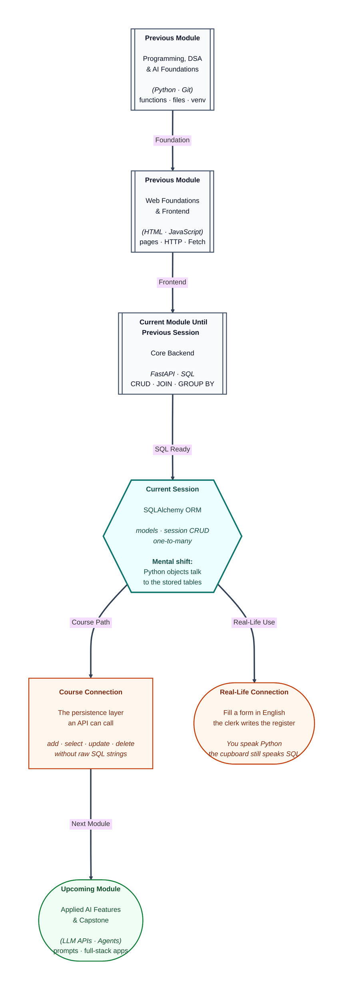

# Pre-read: SQLAlchemy ORM Fundamentals

## Context of This Session in the Course

---

A college office has two languages. You fill an admission form in ordinary English. The register behind the desk is written in the office’s own headings: columns, numbers, and rules that a clerk will not break.

You already know that register. In the previous session you asked it for one number per hostel — a count, an average, a highest mark. Those answers were short. The stored student rows did not change. You typed those questions in the SQL Editor, as formal sentences the cupboard understands.

A FastAPI function does not press **Run** in that editor. It is Python. Restart the older notices board and the Python list is empty, even though Asha, Rahul, Meera, Imran, and Neha can still sit in a real database.

**What if every route had to copy a long SQL sentence by hand?** **What if one misspelt column name only failed at midnight?** **What if “Pune House’s students” meant writing a join every time, instead of asking the hostel object for its list?**

The backend needs a **translator**. You speak Python. The cupboard still speaks SQL. That translator is an **ORM** — Object-Relational Mapper. In simple words: a library that maps a Python class to a table, and a Python object to a row.

**SQLAlchemy** is the ORM used in this course. Think of it as the clerk’s rulebook. “Add Asha” becomes an insert. “Find Asha” becomes a select. You do not throw the database away. You stop handwriting every sentence.

---

## Two kinds of forms, two parents

You already use **Pydantic** for a JSON body. That class checks keys and types before a route runs. It is the printed admission form at the desk.

A **SQLAlchemy model** is a different parent. It names the table, the columns, and the rules the cupboard enforces: required name, unique email, optional hostel id. In simple words: the blank register page, not the envelope.

Do not inherit a table class from the JSON form class. Keep two families. The desk checks the letter. The cupboard stores the row. They will work as a pair later, when HTTP calls this layer. Today you stay in Python.

The practice store is a **SQLite** file on your laptop, named `campus.db`. SQLite is a whole database in one file. The ideas — table, key, foreign key — are the same ones you used with PostgreSQL in Supabase. Only the door you open is a local file, so Python can talk to it without the SQL Editor.

---

## A tray, then a stamp

A **session** is the working tray. In simple words: the stack of forms you are editing before the clerk stamps them into the register.

You create hostel objects and student objects in Python. You place them on the tray. **Commit** writes them into `campus.db`. Close the tray without a stamp, and the cupboard never saw the work.

Hostels must exist before a student can point at a hostel id, the same order you used in SQL. Neha’s hostel id stays empty. The five marks stay 90, 80, 91, 70, and 85 — the same campus sample whose class total was 416.

**Read** asks the session for `Student` objects, not for a handwritten grid. Filter by email or by marks of at least 85, and you still get objects with names as attributes. **Update** means load Imran, change his marks, then commit. **Delete** means load Guest House, remove that object, then commit. The other buildings remain.

Run an insert twice on the same unique email, and the unique rule fires. That is the cupboard doing its job, not a mystery.

---

## One hostel, many students — as Python

You already stored one-to-many in SQL: one hostel id on many student rows. A join printed the building name beside the student.

The ORM still stores that foreign key. A **relationship** adds a Python shortcut. Pune House holds a list of student objects. Asha holds one hostel object. Neha holds none. Guest House holds an empty list, not “nobody exists.”

In simple words: the hostel register points at the residents. Each resident form points back at the building. You did not type a join sentence. SQLAlchemy still sends SQL. You can see it when echo is on.

Access the related list while the session is still open. After the tray is put away, the connection is gone, and a lazy lookup can fail.

---

In this pre-read, you'll discover:

- Why an **ORM** sits between FastAPI-facing Python and a stored table, instead of raw SQL strings in every function.
- How a **model** names a table and its rules, and how that differs from a Pydantic JSON form.
- How a **session** plus **commit** creates, reads, changes, and removes rows in a local file database.
- How a **one-to-many** link becomes `hostel.students` and `student.hostel`, including empty lists and none.

---

## What's Next

After the session, you will be able to:

- Explain ORM, engine, session, and model in ordinary sentences, with the clerk-and-register picture.
- Define hostel and student classes that map to tables, including a foreign key.
- Insert the campus sample, read by email and by marks, update Imran, and delete an unused hostel — all from Python.
- Walk Pune House’s students and Asha’s hostel as attributes, and say why Neha’s hostel is empty.

---

## Think About These Before the Session

Bring these to class:

- FastAPI already did create, read, update, delete on a list. SQL already did them in the editor. What is the **third** version, and why does a restart of the list still lose notices?
- If you add Asha on the tray and never stamp, what does another program see in `campus.db`?
- Pydantic checks JSON. SQLAlchemy maps a table. What goes wrong if one class tries to be both parents?
- Pune House has two students. Neha has no hostel. Guest House has nobody. What should `pune.students`, `neha.hostel`, and `guest.students` look like in Python — a list, an object, or nothing?

If you can already summarise a hostel with **COUNT** and **AVG** in the SQL Editor, you are ready to let **Python objects** send those kinds of sentences for you.
