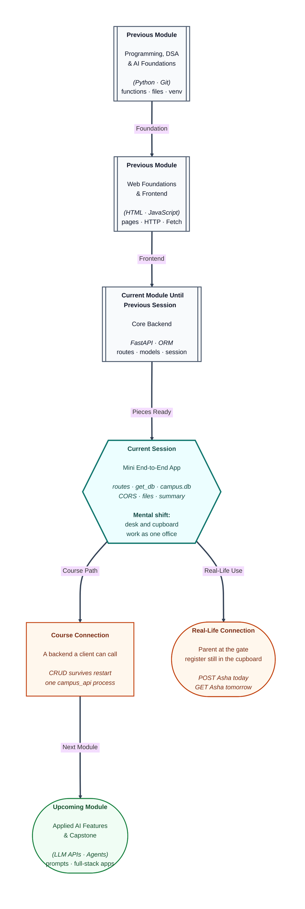

# Pre-read: Hands-on Backend – Mini End-to-End Application

## Context of This Session in the Course

---

A hostel office that only writes sticky notes at the front desk loses every name overnight. An office that only writes in the cupboard never answers a parent at the gate.

You have already run both rooms separately. FastAPI took JSON, checked it with Pydantic, used shared checks, stamped every visit, allowed another port to call, logged after the reply, and saved a file. SQL and then SQLAlchemy stored Asha in a real table. Those ORM scripts never answered HTTP. The notices board answered HTTP and forgot everything on restart.

**What if a parent creates Asha at the desk, you lock the office, and in the morning GET still returns her?** **What if city, hostel average, and a small file upload all live in the same process?** **What if “done” means a route table you can tick, not one lucky 201?**

Today you **assemble** those backend skills into one `campus_api` app. You do not learn a new stack. You join the desk and the cupboard.

Think of it as one office with two rooms and one register. The slip is HTTP. The stamp is middleware. The guest list is CORS. The cupboard is `campus.db`. The clerk’s tray is a session opened for **this** visit and closed after the reply.

---

## What “done” looks like before you type

A finished campus API is not “a student POST that worked once.” It is a small product a page on port **5500** may call. Rows survive a server restart.

Health must read the local settings file. Hostels must exist so a student can point at a real building id. Student create, read, update, and delete must use the JSON forms you already know. The outgoing student JSON should include the **building name**, even though that name is not a column on the student page — it comes from the link, the same idea as a join.

The list should accept an optional city filter. A missing student id is not found, not a crash. A missing email on create is rejected at the desk, before the cupboard writes.

One extra window shows **count and average per hostel**. Guest House stays on that photocopy with count zero, not a fake average of zero. After create, a log line appears **after** the receipt, in a file, not inside the JSON. Upload and download keep the file habit you already practised.

Every reply carries a campus stamp in the headers. CORS is for the other port, not for the docs page on the same port.

If any of those windows is missing, the assemble is not finished. Upcoming work may use an assistant on this same app. Today you type it.

---

## One visit, every layer

A create of Asha walks a fixed path. The method and path choose the window. The JSON form rejects a half-filled slip. A shared helper opens a session. A student object is filled from the slip, placed on the tray, and stamped. The outgoing form copies id and hostel name. The helper closes the tray, even if the id was not found.

That is **end-to-end** in simple words: request in, row stored, JSON out, row still there after you stop the server.

Query city is the filter you already used in SQL, now as an optional question on the URL. Path id is the roll number in the address. Summary is the pile-and-calculator work, now behind HTTP. Files sit beside CRUD. They do not replace the student table.

Two folders stay two folders. The previous Python scripts taught the mapper. This app is the HTTP door. Mixing two database files is the usual reason a successful create looks empty on the next read.

---

In this pre-read, you'll discover:

- Why the desk and the cupboard must share **one** process if a parent is to see a stored name tomorrow.
- Which **windows** a small campus API needs: health, hostels, students, summary, files — not only one create.
- How a visit runs schema, session, stamp, and store, without turning the route into a handwritten SQL essay.
- How restart, city filter, hostel average, and a background log prove the pieces you already learnt are actually wired.

---

## What's Next

After the session, you will be able to:

- Point at a route table and say which window does health, CRUD, summary, and files.
- Create Asha over HTTP, stop the server, and read her again from the same file database.
- Filter Pune, name the building on Asha’s JSON, and show Guest House as zero students.
- Open the log after create, upload a small file, and explain why docs on the same port do not prove CORS.

---

## Think About These Before the Session

Bring these to class:

- You saw **201** for Asha, then restarted the server. If GET is empty, which room did you forget — the desk or the cupboard?
- Why must create send name, email, city, and marks, not only marks, when the outgoing form also shows a hostel name you never typed?
- Guest House has nobody. Should the summary hide it, show count 1, or show count 0 with no average?
- A line appears in a log file **after** the JSON receipt. If you only read the 201 body, did the background job fail, or did you look in the wrong place?

If you can already map a student class to a table in Python, you are ready to put that class **behind a door** a browser can knock on.
