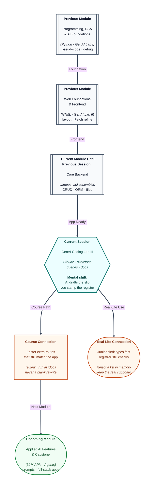

# Pre-read: GenAI Coding Lab III

## Context of This Session in the Course

---

A college office sometimes asks a junior clerk to type a form. The clerk is fast. The registrar still stamps the register. If the draft puts email on the hostel page, the stamp is refused.

You already assembled a real office: `campus_api`. Create stored Asha in a file database. Restart still returned her, with the building name on the JSON. Health, city filter, hostel summary, visit stamps, a guest list for another port, a log after create, and file upload all sit in that one app.

Earlier labs in this course used an assistant for problem-solving intuition, then for page layout and browser calls. This lab is the **backend** pass. You do not open a blank folder.

**What if chat invents a student list in memory and you paste it over the cupboard?** **What if “make it better” deletes upload and summary because they were not in the last message?** **What if an example JSON forgets the building name your outgoing form already sends?**

**Claude** is the junior clerk. In simple words: a chat assistant that drafts Python from your instructions. It has not opened your database file. It has not seen your local settings. You remain the registrar.

---

## The office you must not demolish

Before any draft, the product is already defined. Health reads local settings. Students persist. City is already a question on the list URL — a second city path would only confuse the door. Summary must keep Guest House at count zero. Create must still write the log after the receipt. Files stay multipart, not a fake JSON file field.

The one extra window this lab aims for is a **high-marks** list: students whose marks are at least a number you send. That is not a new city route. It reuses the same student outgoing form, including building name.

Think of a **prompt** as the order slip. “Two dosas, less spicy” works. “Food” does not. A useful slip names the existing app, forbids an in-memory list, forbids deleting CORS and files, and asks for **one** function.

---

## Draft, then stamp, then run

An **AI-assisted workflow** is a loop: brief, prompt, review, run, refine. In simple words: you write the order, the junior types, you test on the real counter.

Review is not a vibe. Session injection must still open and close a tray per visit. Writes must still stamp. Reads must not insert. Column names stay `full_name` and `marks`, not `name` and `score`. Building name is a shortcut on the student object, not a new stored column.

Run means the live docs page, not the chat window. Chat cannot prove restart. Chat cannot see the log file. Chat cannot see a 404 string you already chose.

Refine means a **small change** to one function. “Rewrite the whole office” is how stamps, files, and summary vanish.

Never paste local secrets or real student emails into a public thread. The campus sample on the notes is practice data.

---

## Examples are contracts

A create example for Meera must omit id on the way in and include id and building name on the way out. A missing email is a desk rejection, not a cupboard error. A replace of Imran’s marks still needs the full form, not marks alone.

Upload is a file picker. If a draft shows a JSON file key, it has not looked at your app.

Summary for Guest House is count zero and no average, not average zero. That matches the empty-building story you already proved in SQL, now behind HTTP.

Documentation is labels on counters that **exist**. A pretty paragraph that claims login tokens, or a different database, is a story. Do not paste it.

---

In this pre-read, you'll discover:

- Why the **running campus app** is the source of truth, and why a blank rewrite is not this lab.
- How a tight **instruction slip** asks for one extra window without demolishing CORS, files, or summary.
- How to **review** a draft for the same session, commit, and names you already wired.
- How **examples** and **docs** must match the outgoing student form, including building name and empty-hostel summary.

---

## What's Next

After the session, you will be able to:

- Start the assembled app and say which routes Claude must keep.
- Prompt for a high-marks list, paste only that function, and test it on the docs page.
- Check an ORM draft against the five campus students, including Neha with no hostel.
- Reject a rewrite that stores a list, drops files, or invents login.

---

## Think About These Before the Session

Bring these to class:

- Chat returns a tidy create with no stamp into the cupboard. The JSON looks fine. What does GET after restart show, and who is at fault — the junior or the registrar who pasted?
- Why is a new city path a bad extra, if the list already accepts city as a question on the URL?
- Guest House has nobody. If an example shows average **0**, what mistake did the draft make?
- You ask to “simplify” the main file. Upload disappears. Do you keep the chat version, or restore the office and ask for a smaller change?

If you can already walk the assembled app in the docs page, you are ready to let an assistant **type faster** — and to refuse any draft that unlocks the cupboard.
