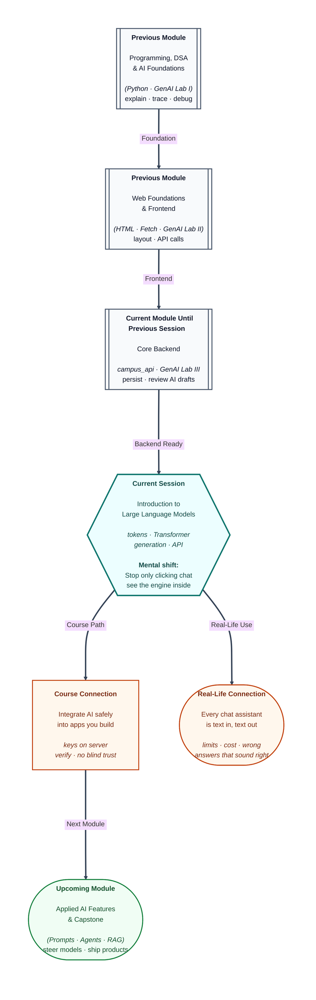

# Pre-read: Introduction to Large Language Models

## Context of This Session in the Course

---

You type one line into a phone app—“Explain this fee rule in simple words”—and an answer appears in seconds. No human picked up the call. It feels like magic, until the same app confidently gives the **wrong** refund date. That gap between **smooth** and **true** is why software teams treat these tools as serious engineering, not toys.

In the **previous** work on this course, you already used chat assistants to learn DSA, polish web pages, and draft backend routes for a real campus app. You learned to **review** every draft before running it. Today’s topic is not “which button to click.” It is **what sits behind the button**: a **Large Language Model**, or **LLM** for short—in simple words, a system trained on huge amounts of text to guess what words should come next.

---

## When the assistant sounds sure but is wrong

Picture a hostel helpdesk. A student asks, “How many beds are free in Block C **right now**?” A new clerk answers “Twenty-three” without opening the register. The voice is calm. The number is invented. That is the daily risk with LLMs: they are built to **continue language smoothly**, not to **open your database**.

**What if** you paste three long error logs and a full main file into chat, then ask for one fix—and the reply “fixes” a route that never existed? **What if** you ask for student JSON and get a field name that **looks** professional but does not match your live API docs? **What if** two students ask the same simple question and get different poetic answers?

These are not rare pranks. They follow from how the engine works. If you only treat the chat window as a oracle, you will ship bugs. If you understand **tokens**, **context limits**, and **randomness settings** like **temperature**, you can choose when to trust, when to verify, and where to put the API key in a real product (hint: not in the browser).

---

## The idea we unpack in the live session

A **Large Language Model** does not “think” like a person. It breaks your sentence into small pieces called **tokens**—in simple words, bite-sized chunks of text, sometimes whole words, sometimes parts of words or punctuation. Those pieces become numbers. A design called a **Transformer** (no need to fear the name yet) helps the model relate each piece to the others—like noticing that “hostel” and “building name” belong together in a campus form.

Then the model predicts **one next token at a time**, again and again, until it stops. That step-by-step writing is why answers appear word by word in the UI. Settings such as **temperature** control how **safe** versus **creative** the next word choice feels. Ask “What is the colour of the sky?” with a **low** temperature and you often get a short factual line: the sky is blue. Ask again with a **high** temperature and you might get something longer and poetic—still about blue, but with different wording each time.

None of that replaces your **campus database**. It replaces **typing**—fast drafting, explaining, summarising—when you keep humans (you) in the loop.

---

## One analogy to carry into class

Think of an LLM as a **very well-read autocomplete** on your phone keyboard—one that has read textbooks, forums, and documentation across the internet. It suggests the next word based on patterns, not based on opening your cupboard. Your job as a developer is to decide **when autocomplete is enough**, when you must **fetch real data from your backend**, and when a confident paragraph is a **hallucination**—a fluent guess that was never checked.

That is the same discipline you already used when an AI draft tried to swap your persistent student list for a temporary one. The engine did not mean harm; it predicted text. **You** own the register.

---

In this pre-read, you'll discover:

- What an **LLM** actually is, without maths fear—and how it differs from the apps and APIs you have already built.
- Why **tokenization** matters for cost, limits, and why long pasted files “fall off” the end of memory.
- How a **Transformer** fits into the story at a **high level**, without building one from scratch.
- How text is **received** and **generated** step by step—and why **temperature** changes tone, not facts.
- Why this knowledge matters before you wire AI into **frontend**, **backend**, or full-stack products in the rest of the module.

---

## Why this matters for your developer path

Companies do not hire you only to drag blocks in a chat UI. They hire you to **integrate** services safely: student portal help text generated on the server, admin summaries fed with **real** SQL counts, error hints that never leak secrets. You already know HTTP, JSON, and review habits from backend work. LLMs become **one more external service**—powerful, expensive if misused, and dangerous when trusted blindly.

The **next** topics in this module will show you how to **steer** answers with better instructions. Today you learn the **machine** you are steering.

---

## What's Next

After the session, you will be able to:

- Explain to a non-tech teammate what an **LLM** does in one clear paragraph.
- Describe **tokens** and why word count and token count are not the same.
- Sketch the path from **your text → model → generated text** without hand-waving “AI magic.”
- Say when **low temperature** is appropriate versus when creative wording is worth the risk.
- Argue why API keys belong on the **server**, and why chat can **hallucinate** counts and field names.

---

## Think About These Before the Session

Bring your curiosity—the live session works through these ideas:

- You ask an assistant how many students live in **your** city filter result **without** sending any JSON from your app. It answers with a number. Should you paste that into a report? Why or why not?
- Same question: “What is the colour of the sky?” Why might a **low** temperature answer look like a textbook line, while a **high** temperature answer sounds like a poem—but both mention blue?
- Your classmate says, “The model **remembered** my project from last week.” What actually gets sent on each new chat request, and what lives only on **your** laptop or server?
- A product manager wants the Gemini key inside the mobile app “for speed.” What could go wrong in the first week after launch?

If you have ever used an AI assistant in this course and still checked the result on your machine, you are already halfway there. The live session opens the hood—so the next time the keyboard finishes your sentence, you know **who** is finishing it and **what** to verify before you ship.
