# Pre-read: Prompt Engineering

## Context of This Session in the Course

```mermaid
%%{init: {"diagramPadding": 24, "flowchart": {"htmlLabels": true, "nodeSpacing": 90, "rankSpacing": 110, "curve": "basis", "padding": 20}, "theme": "base", "themeVariables": {"fontFamily": "Arial", "fontSize": "15px", "lineColor": "#334155"}}}%%
flowchart TB
    subgraph FOUNDATION[" "]
        direction LR
        PM1[["&nbsp;&nbsp;<b>Previous Module</b>&nbsp;&nbsp;<br/><br/>Programming, DSA<br/>&amp; AI Foundations<br/><br/><i>(Python · GenAI Lab I)</i><br/>explain · trace · debug"]]
        PM2[["&nbsp;&nbsp;<b>Previous Module</b>&nbsp;&nbsp;<br/><br/>Web Foundations<br/>&amp; Frontend<br/><br/><i>(HTML · Fetch · GenAI Lab II)</i><br/>layout · API calls"]]
        PM3[["&nbsp;&nbsp;<b>Previous Module</b>&nbsp;&nbsp;<br/><br/>Core Backend<br/><br/><i>(FastAPI · campus_api)</i><br/>CRUD · ORM · review"]]
    end

    CM[["&nbsp;&nbsp;<b>Current Module Until Previous Session</b>&nbsp;&nbsp;<br/><br/>Applied AI intro<br/><br/><i>LLM · tokens · Gemini</i><br/>engine · temperature"]]

    CURRENT{{"&nbsp;&nbsp;<b>Current Session</b>&nbsp;&nbsp;<br/><br/>Prompt Engineering<br/><br/><i>structure · shots<br/>roles · JSON</i><br/><br/><b>Mental shift:</b><br/>Steer the engine<br/>with clear instructions"}}

    subgraph VALUE[" "]
        direction LR
        COURSE["&nbsp;&nbsp;<b>Course Connection</b>&nbsp;&nbsp;<br/><br/>Better AI drafts<br/>for real apps<br/><br/><i>constraints · format<br/>few-shot · validate</i>"]
        REAL(["&nbsp;&nbsp;<b>Real-Life Connection</b>&nbsp;&nbsp;<br/><br/>Clear briefs at work<br/>fewer wrong fields<br/><br/><i>JSON contracts<br/>no mystery output</i>"])
    end

    subgraph FUTURE[" "]
        direction LR
        M4(["&nbsp;&nbsp;<b>Upcoming Module</b>&nbsp;&nbsp;<br/><br/>Applied AI Features<br/>&amp; Capstone<br/><br/><i>(Agents · RAG · tools)</i><br/>wire prompts · ship"])
    end

    PM1 ==>|&nbsp;Foundation&nbsp;| PM2
    PM2 ==>|&nbsp;Frontend&nbsp;| PM3
    PM3 ==>|&nbsp;Backend&nbsp;| CM
    CM ==>|&nbsp;Engine Known&nbsp;| CURRENT
    CURRENT ==>|&nbsp;Course Path&nbsp;| COURSE
    CURRENT ==>|&nbsp;Real-Life Use&nbsp;| REAL
    COURSE ==>|&nbsp;Next Module&nbsp;| M4

    classDef previous fill:#f8fafc,stroke:#475569,stroke-width:2px,color:#0f172a
    classDef current fill:#ecfeff,stroke:#0f766e,stroke-width:3px,color:#134e4a
    classDef value fill:#fff7ed,stroke:#c2410c,stroke-width:2px,color:#7c2d12
    classDef future fill:#f0fdf4,stroke:#15803d,stroke-width:2px,color:#14532d

    class PM1,PM2,PM3 previous
    class CM previous
    class CURRENT current
    class COURSE,REAL value
    class M4 future

    style FOUNDATION fill:transparent,stroke:transparent
    style VALUE fill:transparent,stroke:transparent
    style FUTURE fill:transparent,stroke:transparent
    linkStyle default stroke:#334155,stroke-width:3px
```

---

You open a chat app and type **“Fix my project.”** The reply is long, confident, and wrong—it renames fields, invents a route, and never asks what stack you use. You close the tab feeling the tool is “useless.” Often the tool was fine; the **instruction** was empty.

In the **previous** lesson you looked under the hood: text becomes **tokens**, models predict the next piece, **temperature** changes tone, and a simple **API call** returns an answer in the console. You learned that the machine does not see your database or your running server unless **you put facts in the message**. Today is the next step: **prompt engineering**—designing what you write so answers are **scoped, checkable, and in the shape you need**.

---

## The gap between a wish and a brief

Imagine two people ordering food at the same counter.

- Person A says: **“Something good.”**
- Person B says: **“Two plates, less spicy, no onion, ready by 1 pm, bill under ₹200.”**

Same kitchen. Very different plates. An **LLM** (large language model—in simple words, a text-prediction engine behind chat tools) behaves like that kitchen. It will **fill silence with plausible words**. Without a brief, plausibility is not truth.

**What if** you ask it to “explain our student API” but never say which fields exist—and it adds a **`gpa`** column your app never had? **What if** you need a **short** answer for a help popup, but you get a three-page essay because you never mentioned length? **What if** two teammates use the same tool on the same bug and get different fixes because one pasted the traceback and one did not?

Those failures are usually **prompt failures**. Your course already taught you to **review** AI drafts on a real **campus backend** before trusting them. Prompt engineering names the levers you have been using without labels: **role**, **context**, **task**, **format**, and **constraints**.

---

## What “prompt engineering” means here

- **Prompt engineering** is the skill of writing instructions so the model’s output matches your task, audience, and format.
- It is not memorising magic sentences. It is **clear writing** plus a few repeatable patterns.
- It applies in chat tools **and** in API calls—the model still only sees **text you send**.

You will meet techniques by name in the live session:

| Idea | In one line |
| --- | --- |
| **Zero-shot** | Instructions only—no worked example in the message |
| **Few-shot** | You show one or two mini examples of the answer you want |
| **Chain-of-thought** | You ask the model to show steps before the final answer |
| **Role prompting** | You say *who* it should sound like (tutor, reviewer, doc writer) |
| **Structured output** | You demand JSON or fixed keys so you can validate like a form |

None of these replace **`/docs`**, SQL, or running Uvicorn. They reduce how often you chase **hallucinations**—answers that sound perfect but were never grounded in your app.

---

## One analogy: the instruction slip at the office

Think of every prompt as an **instruction slip** on a clerk’s desk.

- **Role** is the stamp: “Typed by: backend reviewer.”
- **Context** is the photocopied page you attach—one error line, not the whole file cabinet.
- **Task** is the single job: “List three checks,” not “fix everything.”
- **Format** is “numbered lines” or “JSON with these keys only.”
- **Constraints** is “do not invent routes; say unknown if data is missing.”

When you wrapped Claude with **stack rules** and **one task** in the GenAI lab, you were already writing half of this slip. Today you learn the full layout—and when to add **examples** or **step-by-step reasoning**.

---

## Temperature and prompts work together

You already saw **temperature**: low often gives a plain sky-is-blue line; higher gives more colourful wording. **Prompt structure** decides **what** must be true; **temperature** decides **how** creatively it is phrased.

For **field names**, **status codes**, and **JSON keys**, teams usually combine **strict prompts** with **low randomness**. For brainstorming copy on a landing page, they may loosen both. The live session connects these knobs to the same **Gemini** lab pattern you used before—this time swapping **technique**, not re-explaining Transformers.

---

In this pre-read, you'll discover:

- How to **structure** a prompt so the model stops guessing your intent.
- When **zero-shot** is enough—and when **few-shot** or **chain-of-thought** saves you from vague fixes.
- How **role** changes tone without giving the model permission to invent facts.
- Why **structured output** matters before you wire LLM text into a backend route.
- How this fits the **review habit** you already use on real campus API work.

---

## What's Next

After the session, you will be able to:

- Rewrite a vague one-line ask into **role + context + task + format + constraints**.
- Name and choose among **zero-shot**, **few-shot**, and **chain-of-thought** for a given problem.
- Draft a **JSON-shaped** prompt that lists allowed keys for a single API field.
- Explain why a **role** alone does not let the model “see” your database.
- Connect prompt blocks to the **wrapper** you use when an assistant drafts backend code.

---

## Think About These Before the Session

Bring these—not code, just your judgment:

- You write: **“Explain StudentOut.”** What is missing compared to listing actual field names and asking for a two-column table?
- Why might showing **one** correct example (question + short answer) produce steadier docs than adding ten adjectives like “be detailed”?
- When a model gives **JSON with extra keys**, is that a model bug, a temperature bug, or a **prompt** bug?
- Your friend says: **“I am a senior architect”** in the prompt, so the answer must be right. What still must come from **your** running app or pasted context?

If you can spot a weak brief before you blame the tool, you are ready. The live session turns that instinct into **patterns you can reuse** on every integration—not one-off chat luck.
