# Pre-read: AI API Integration

## Context of This Session in the Course

```mermaid
%%{init: {"diagramPadding": 24, "flowchart": {"htmlLabels": true, "nodeSpacing": 90, "rankSpacing": 110, "curve": "basis", "padding": 20}, "theme": "base", "themeVariables": {"fontFamily": "Arial", "fontSize": "15px", "lineColor": "#334155"}}}%%
flowchart TB
    subgraph FOUNDATION[" "]
        direction LR
        PM1[["&nbsp;&nbsp;<b>Previous Module</b>&nbsp;&nbsp;<br/><br/>Programming, DSA<br/>&amp; AI Foundations<br/><br/><i>(Python · GenAI Lab I)</i><br/>explain · trace · debug"]]
        PM2[["&nbsp;&nbsp;<b>Previous Module</b>&nbsp;&nbsp;<br/><br/>Web Foundations<br/>&amp; Frontend<br/><br/><i>(HTML · Fetch · GenAI Lab II)</i><br/>layout · API calls"]]
        PM3[["&nbsp;&nbsp;<b>Previous Module</b>&nbsp;&nbsp;<br/><br/>Core Backend<br/><br/><i>(FastAPI · campus_api)</i><br/>CRUD · ORM · review"]]
    end

    CM[["&nbsp;&nbsp;<b>Current Module Until Previous Session</b>&nbsp;&nbsp;<br/><br/>LLM intro &amp; prompts<br/><br/><i>tokens · roles · JSON</i><br/>brief the model well"]]

    CURRENT{{"&nbsp;&nbsp;<b>Current Session</b>&nbsp;&nbsp;<br/><br/>AI API Integration<br/><br/><i>providers · keys<br/>chat · stream</i><br/><br/><b>Mental shift:</b><br/>AI leaves the chat tab<br/>and lives in your API"}}

    subgraph VALUE[" "]
        direction LR
        COURSE["&nbsp;&nbsp;<b>Course Connection</b>&nbsp;&nbsp;<br/><br/>FastAPI + LLM<br/>like any other service<br/><br/><i>auth · messages<br/>rate limits</i>"]
        REAL(["&nbsp;&nbsp;<b>Real-Life Connection</b>&nbsp;&nbsp;<br/><br/>Support bots &amp; copilots<br/>need a secure server<br/><br/><i>keys never in browser<br/>streaming UX</i>"])
    end

    subgraph FUTURE[" "]
        direction LR
        UM1(["&nbsp;&nbsp;<b>Upcoming Module</b>&nbsp;&nbsp;<br/><br/>Capstone build<br/><br/><i>(schema · vision<br/>embeddings)</i><br/>richer AI features"])
    end

    PM1 ==>|&nbsp;Foundation&nbsp;| PM2
    PM2 ==>|&nbsp;Frontend&nbsp;| PM3
    PM3 ==>|&nbsp;Backend&nbsp;| CM
    CM ==>|&nbsp;Prompts Ready&nbsp;| CURRENT
    CURRENT ==>|&nbsp;Course Path&nbsp;| COURSE
    CURRENT ==>|&nbsp;Real-Life Use&nbsp;| REAL
    COURSE ==>|&nbsp;Next Module&nbsp;| UM1

    classDef previous fill:#f8fafc,stroke:#475569,stroke-width:2px,color:#0f172a
    classDef current fill:#ecfeff,stroke:#0f766e,stroke-width:3px,color:#134e4a
    classDef value fill:#fff7ed,stroke:#c2410c,stroke-width:2px,color:#7c2d12
    classDef future fill:#f0fdf4,stroke:#15803d,stroke-width:2px,color:#14532d

    class PM1,PM2,PM3 previous
    class CM previous
    class CURRENT current
    class COURSE,REAL value
    class UM1 future

    style FOUNDATION fill:transparent,stroke:transparent
    style VALUE fill:transparent,stroke:transparent
    style FUTURE fill:transparent,stroke:transparent
    linkStyle default stroke:#334155,stroke-width:3px
```

---

Your college website adds a **“Ask anything”** box. Within a week, someone pastes the **API key** into a public GitHub repo, a student shares a screenshot of the key in a WhatsApp group, and the bill shows **lakhs of rupees** in model usage because bots hammered the endpoint all night. The feature looked magical in a demo; in production it was a **leaky pipe** with no guardrails.

In the **previous** lessons you learned how an **LLM** (large language model—a system that predicts text) works and how to **write prompts** with roles, constraints, and structured shapes. You practiced in chat tools and small scripts. The missing piece for a real product is **integration**: your **FastAPI** backend must call the provider the same way it calls a database—**authenticated**, **controlled**, and **observable**.

---

## When the assistant must live inside your app

Imagine you run a small **campus helpdesk**. Students should ask: *“What is the fee deadline?”* and get an answer grounded in your official notice—not a confident guess.

**What if** every answer is typed by staff during peak admission season? **What if** you embed a chat widget that sends the student’s question **directly** from the browser to OpenAI or Google, along with your secret key? Anyone can open browser tools and **copy that key**. **What if** fifty users hit “send” at once and your server opens fifty full responses with no queue—some users stare at a blank screen for thirty seconds?

Those are not “AI problems.” They are **API integration** problems: **where** the call happens, **who** holds the key, **how** messages are structured, and **what** you do when the provider says **slow down** or **pay more**.

**AI API integration** means wiring an LLM provider into your backend so your frontend talks only to **your** server, and your server talks to the model with rules you control.

---

## Providers, keys, and the chat-shaped request

Several companies offer **LLM APIs**—hosted models you reach over HTTPS. Names you will hear include **OpenAI**, **Google** (Gemini), and **Anthropic** (Claude). They differ in pricing, models, and features, but the **integration pattern** is similar: register, get an **API key** (a secret password for your project), send a **request**, receive **text** (or a stream of text).

| Piece | What it means for you |
| --- | --- |
| **Provider** | The company hosting the model; you choose based on policy, cost, and features |
| **API key** | Secret credential—lives in **environment variables** on the server, never in frontend code |
| **Chat API** | You send a **list of messages**, not one blob of text |
| **Roles** | **System** sets behaviour, **user** asks, **assistant** is the model’s prior reply in the thread |

You already used **system / user** ideas in prompt engineering. The API formalises them: each message has a **role** and **content**. Your FastAPI route can build that list from the student’s question plus a fixed system line (“Answer only from the attached notice; say unknown if missing”).

**Authentication** is not optional decoration. If the key leaks, strangers can spend your quota. Teams store keys in `.env` files or secret managers, load them at startup, and **never** log them.

---

## Streaming, rate limits, and a calm user experience

Have you watched a long answer **appear word by word** in a chat app? That is often **streaming**: the server receives tokens as they are generated and forwards them, so the UI feels alive instead of frozen.

**What if** you wait for the **entire** essay before showing anything? Users assume the app crashed. Streaming is a **product** choice tied to how you read the HTTP response.

**Rate limits** are the provider’s way of saying *“not so fast.”* You may get HTTP **429** or similar when you exceed requests per minute. Good integration **retries with backoff**, **queues** heavy jobs, or **caches** frequent answers. Bad integration loops instantly and makes things worse.

Think of your backend as a **polite receptionist** at a busy clinic: one counter, a token system, and clear signs when the doctor is occupied—not fifty people rushing the same door.

---

## One analogy: the restaurant with a single service counter

Picture a popular **dosa** shop. Customers do not walk into the kitchen. They place an order at the **counter**. The counter checks payment, passes the order inside, and brings the plate out. The **recipe** and **gas stove** stay behind the wall.

Your **frontend** is the customer at the counter. Your **FastAPI app** is the counter staff. The **LLM provider** is the kitchen. The **API key** is the shop’s wholesale account—if you hand it to every customer, anyone can order a thousand plates on your bill.

**Prompt engineering** is how you write the order slip (“two plain, less oil”). **API integration** is building the counter process: validate input, attach the slip, call the kitchen, handle delays, and serve the plate—**without** exposing the wholesale account.

---

In this pre-read, you'll discover:

- How **LLM providers** fit into a **FastAPI** backend you already understand from campus API work.
- Why **API keys** belong on the **server** and what goes wrong when they sit in the browser.
- How **chat-style messages** with **roles** connect to the prompts you designed earlier.
- What **streaming** changes for users staring at a loading spinner.
- How **rate limits** show up in real integrations and why graceful handling matters.

---

## What's Next

After the session, you will be able to:

- Name major **LLM API providers** and describe the shared **request–response** pattern.
- Explain a secure **API key** setup for a small FastAPI service.
- Sketch a **chat payload** with **system**, **user**, and optional **assistant** history.
- Compare **buffered** vs **streaming** responses for a helpdesk-style feature.
- List practical responses when a provider returns **rate limit** errors.

---

## Think About These Before the Session

Bring judgment—not code snippets:

- A teammate says: *“We’ll call Gemini from React so it’s faster.”* What could go wrong with the **key** and with **billing**?
- Why might a **system** message be stored only on the server while the **user** message comes from the form?
- If users see text **typing out** live, is the model definitely “thinking faster,” or is something else happening on the wire?
- Your app gets **429 Too Many Requests** during a college fest. Is the first fix “buy a bigger model,” or something about **traffic shaping**?

When you can picture the **counter** between browser and model, you are ready to wire AI like any other backend dependency—securely, clearly, and ready for the richer features ahead in this module.
