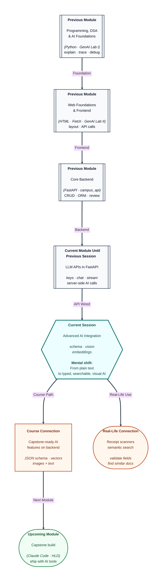

# Pre-read: Advanced AI Integration

## Context of This Session in the Course

---

A shop uploads **product photos** to a “smart catalog” tool. The model returns a paragraph: *“This appears to be a blue cotton shirt, probably size M, price around ₹899.”* Your inventory system needs **`sku`**, **`color`**, **`size`**, and **`price_inr`** as separate fields. The paragraph looks helpful; your database import **crashes** because keys do not match.

In the **previous** lesson you connected an **LLM API** to **FastAPI**: keys on the server, **chat messages** with roles, optional **streaming**, and respect for **rate limits**. Plain text replies were enough for a helpdesk demo. Real products often need **structured**, **searchable**, and **visual** intelligence—not only free-form paragraphs.

---

## When free text is not enough

Imagine a **library app** for your college.

**What if** a student searches *“books like the one on climate policy we read in first year”* but your search only matches exact titles? **What if** a user uploads a **photo of a book cover** and expects the app to suggest the right entry? **What if** an admin dashboard needs a **JSON object** with fixed keys so the frontend can render a form—not a essay?

Those gaps lead to four ideas you will deepen in the live session:

| Capability | Plain English |
| --- | --- |
| **Structured outputs** | The model must answer in a **shape you define** (fields and types), like a filled form |
| **Vision APIs** | The model can **look at an image** and describe or classify what it sees |
| **Embeddings** | Text becomes a **numeric fingerprint** so “similar meaning” can be found even when words differ |
| **Multimodal integration** | You combine **text, images, and vectors** in one backend flow |

None of this replaces your **database** or **validation** in FastAPI. It extends what your server can **ask** the model to return—and how you **store** and **search** the results.

---

## Structured outputs: forms, not essays

You already practiced **structured prompting**—demanding JSON with named keys. **Structured outputs** (provider-supported response schemas) push reliability further: the API can **constrain** the model to produce data that matches a **schema** (a blueprint of allowed fields).

**What if** the model invents a field `discount_percent` when your capstone only allows `title` and `tags`? A schema-aware response reduces cleanup code and angry frontend developers.

Think of it as switching from *“write something about this product”* to *“fill this exact table row.”* Your Pydantic models on the backend and the model’s output start to **speak the same language**.

---

## Vision and embeddings in one line each

**Vision APIs** let you send an **image** (or image URL) along with instructions: *“Is this a valid fee receipt?”* *“List visible text.”* *“Which category icon is this?”* The model returns text—or structured data—you still verify.

**Embeddings** turn a sentence into a **vector** (a long list of numbers). Two sentences with similar meaning get **vectors close together**. That powers **semantic search**: find the right FAQ even when the student’s wording does not match your document word-for-word.

**Multimodal integration** means your FastAPI route might: accept upload → call vision → store embedding → return structured JSON to the client. Each step has failure modes you plan for, just like SQL errors.

---

## One analogy: the customs desk with three counters

At an airport **customs** desk, three jobs happen in order:

1. **Inspect the bag** (vision—what is inside?).
2. **Stamp the form** with fixed boxes (structured output—no scribbles in the margin).
3. **File the form in a drawer sorted by similarity** (embeddings—find related cases later).

You would not let every traveller write a poem about their luggage and call it done. Your backend should not treat every AI reply as a poem either.

---

In this pre-read, you'll discover:

- Why **schema-validated** model responses matter before data hits your database.
- How **vision** features change backend design when users upload images.
- What **embeddings** enable for **semantic search** beyond keyword match.
- How to think about **multimodal** flows as chained responsibilities on the server.
- How this builds on **secure API integration** you already practiced.

---

## What's Next

After the session, you will be able to:

- Explain **structured outputs** vs unstructured paragraphs for app integration.
- Describe a sensible **vision** use case and what you still must validate manually.
- Define **embedding** in beginner terms and name one **search** benefit.
- Sketch how **text + image + vector** steps fit inside a single backend feature.
- Connect these tools to **capstone** features you may add soon.

---

## Think About These Before the Session

- A model returns JSON with an extra field your UI does not expect. Is that only a frontend bug, or also an **output shape** problem?
- Why should **image uploads** usually go to **your** server first instead of straight to the provider from the browser?
- Two questions word very differently but mean the same. Would **keyword search** always find both? What does an **embedding** help with?
- Your friend says vision AI “reads minds” from photos. What kinds of mistakes would you still check for on a **fee receipt** upload?

When you can separate **poetry** from **forms**, **pixels** from **facts**, and **similar meaning** from **identical words**, you are ready to add advanced AI features the way product teams do—not as magic, but as designed backend behaviour.
