# Pre-read: Claude Code for AI Development

## Context of This Session in the Course

```mermaid
%%{init: {"diagramPadding": 24, "flowchart": {"htmlLabels": true, "nodeSpacing": 90, "rankSpacing": 110, "curve": "basis", "padding": 20}, "theme": "base", "themeVariables": {"fontFamily": "Arial", "fontSize": "15px", "lineColor": "#334155"}}}%%
flowchart TB
    subgraph FOUNDATION[" "]
        direction LR
        PM1[["&nbsp;&nbsp;<b>Previous Module</b>&nbsp;&nbsp;<br/><br/>Programming, DSA<br/>&amp; AI Foundations<br/><br/><i>(Python · GenAI Lab I)</i><br/>explain · trace · debug"]]
        PM2[["&nbsp;&nbsp;<b>Previous Module</b>&nbsp;&nbsp;<br/><br/>Web Foundations<br/>&amp; Frontend<br/><br/><i>(HTML · Fetch · GenAI Lab II)</i><br/>layout · API calls"]]
        PM3[["&nbsp;&nbsp;<b>Previous Module</b>&nbsp;&nbsp;<br/><br/>Core Backend<br/><br/><i>(FastAPI · campus_api)</i><br/>CRUD · ORM · review"]]
    end

    CM[["&nbsp;&nbsp;<b>Current Module Until Previous Session</b>&nbsp;&nbsp;<br/><br/>Rich AI on backend<br/><br/><i>schema · vision · vectors</i><br/>multimodal features"]]

    CURRENT{{"&nbsp;&nbsp;<b>Current Session</b>&nbsp;&nbsp;<br/><br/>Claude Code for<br/>AI Development<br/><br/><i>CLI · iterate<br/>debug · prompts</i><br/><br/><b>Mental shift:</b><br/>Pair with AI<br/>inside your repo"}}

    subgraph VALUE[" "]
        direction LR
        COURSE["&nbsp;&nbsp;<b>Course Connection</b>&nbsp;&nbsp;<br/><br/>Faster capstone<br/>with guided AI dev<br/><br/><i>project context<br/>safe iteration</i>"]
        REAL(["&nbsp;&nbsp;<b>Real-Life Connection</b>&nbsp;&nbsp;<br/><br/>Modern teams use<br/>coding assistants<br/><br/><i>you still review<br/>every diff</i>"])
    end

    subgraph FUTURE[" "]
        direction LR
        UM1(["&nbsp;&nbsp;<b>Upcoming Module</b>&nbsp;&nbsp;<br/><br/>Capstone design<br/><br/><i>(HLD · schema)</i><br/>blueprint before build"])
    end

    PM1 ==>|&nbsp;Foundation&nbsp;| PM2
    PM2 ==>|&nbsp;Frontend&nbsp;| PM3
    PM3 ==>|&nbsp;Backend&nbsp;| CM
    CM ==>|&nbsp;Features Ready&nbsp;| CURRENT
    CURRENT ==>|&nbsp;Course Path&nbsp;| COURSE
    CURRENT ==>|&nbsp;Real-Life Use&nbsp;| REAL
    COURSE ==>|&nbsp;Next Module&nbsp;| UM1

    classDef previous fill:#f8fafc,stroke:#475569,stroke-width:2px,color:#0f172a
    classDef current fill:#ecfeff,stroke:#0f766e,stroke-width:3px,color:#134e4a
    classDef value fill:#fff7ed,stroke:#c2410c,stroke-width:2px,color:#7c2d12
    classDef future fill:#f0fdf4,stroke:#15803d,stroke-width:2px,color:#14532d

    class PM1,PM2,PM3 previous
    class CM previous
    class CURRENT current
    class COURSE,REAL value
    class UM1 future

    style FOUNDATION fill:transparent,stroke:transparent
    style VALUE fill:transparent,stroke:transparent
    style FUTURE fill:transparent,stroke:transparent
    linkStyle default stroke:#334155,stroke-width:3px
```

---

You inherit a **buggy capstone repo** on Sunday night. The login button does nothing. The console shows a vague error. You open a chat tab, paste half the project, and get a fix that **renames three files** you never mentioned. Monday demo still feels far away.

In the **previous** lessons you learned **prompt structure** and **backend AI integration**. You can brief a model well and call APIs safely. What you have not yet systematised is **working inside your actual project folder**—with file context, small steps, and **reviewable** changes. That is where **Claude Code** fits: a **command-line** coding assistant that treats your repo as the workspace, not a one-off paste box.

---

## The gap between “chat advice” and “changed files”

**What if** every fix requires you to manually hunt paths, copy snippets, and hope you did not miss an import? **What if** the model suggests a library you are not allowed to use in the capstone rubric? **What if** you need to **iterate**: run the app, read the traceback, adjust one route, test again?

Traditional chat is like a senior developer shouting suggestions from another building. **Claude Code** is closer to a **pair programmer** sitting at your machine—**if** you learn its workflow: install, initialise in a project, give **focused** tasks, and **read every diff** like you would a teammate’s pull request.

This session is not “AI replaces learning.” It is **AI accelerates** the loops you already know: edit, run, debug, commit—while **you** stay responsible for correctness.

---

## Installation, CLI, and project context

You will cover **installation and setup** so the tool runs in your environment, then **CLI basics**: starting a session in the right directory, pointing at the capstone (or practice) repo, and issuing commands that map to real actions—explain a file, propose a patch, run tests if configured.

**Development workflow** means **small slices**: “Fix the fetch URL on the login form,” not “build entire backend.” Each slice gets a run-check. **Debugging** means feeding the **exact error text**, the **file you suspect**, and what you already tried—mirroring the prompt discipline from earlier modules.

**Best practices** repeat what industry teams preach: never paste secrets; do not accept large rewrites without understanding; keep commits small; use the same **review habit** you applied to AI drafts on **campus_api**.

---

## One analogy: the workshop apprentice with a tool belt

Picture a **furniture workshop**. The master carpenter still decides the design and inspects joints. The apprentice fetches the right clamp, holds the board steady, and sweeps shavings—but does not secretly replace oak with plywood.

**Claude Code** is the apprentice with a **tool belt** (search, edit, explain). **You** are the carpenter who signs off on whether the chair holds weight. If you skip inspection, the demo wobbles.

---

In this pre-read, you'll discover:

- How **Claude Code** differs from a generic browser chat for **repo-based** work.
- What **installation and CLI workflow** look like at a beginner level.
- How to **iterate** in small steps instead of one giant “fix my project” ask.
- How **debugging with AI** still requires **your** traceback and reproduction steps.
- How prompting rules from earlier lessons apply inside the **terminal pairing** style.

---

## What's Next

After the session, you will be able to:

- Install and **configure** Claude Code for local development.
- **Initialize** work in a project directory using CLI patterns from class.
- Run an **iterative** change loop: task → change → run → adjust.
- Apply **debugging prompts** that include errors, files, and constraints.
- Explain why **you** remain accountable for every merged change.

---

## Think About These Before the Session

- Why is *“fix my capstone”* a weaker prompt than *“in `login.js`, the submit handler never calls fetch—here is the console error”*?
- If the tool renames a file you did not mention, what should you do **before** running the app again?
- Where should **API keys** live when using a terminal coding assistant—`.env`, chat message, or README?
- How is reviewing an AI-generated diff similar to the **GenAI lab** rule: trust but verify against your running server?

When you see the terminal as a **collaboration surface**—not a magic wand—you are ready to use Claude Code the way working developers do: faster loops, same professional standards.
