# Pre-read: Introduction to the Capstone Project

## Context of This Session in the Course

```mermaid
%%{init: {"diagramPadding": 24, "flowchart": {"htmlLabels": true, "nodeSpacing": 90, "rankSpacing": 110, "curve": "basis", "padding": 20}, "theme": "base", "themeVariables": {"fontFamily": "Arial", "fontSize": "15px", "lineColor": "#334155"}}}%%
flowchart TB
    subgraph FOUNDATION[" "]
        direction LR
        PM1[["&nbsp;&nbsp;<b>Previous Module</b>&nbsp;&nbsp;<br/><br/>Programming, DSA<br/>&amp; AI Foundations<br/><br/><i>(Python · GenAI Lab I)</i><br/>explain · trace · debug"]]
        PM2[["&nbsp;&nbsp;<b>Previous Module</b>&nbsp;&nbsp;<br/><br/>Web Foundations<br/>&amp; Frontend<br/><br/><i>(HTML · Fetch · GenAI Lab II)</i><br/>layout · API calls"]]
        PM3[["&nbsp;&nbsp;<b>Previous Module</b>&nbsp;&nbsp;<br/><br/>Core Backend<br/><br/><i>(FastAPI · campus_api)</i><br/>CRUD · ORM · review"]]
    end

    CM[["&nbsp;&nbsp;<b>Current Module Until Previous Session</b>&nbsp;&nbsp;<br/><br/>AI dev workflow<br/><br/><i>Claude Code · CLI</i><br/>iterate in repo"]]

    CURRENT{{"&nbsp;&nbsp;<b>Current Session</b>&nbsp;&nbsp;<br/><br/>Capstone Introduction<br/><br/><i>HLD · LLD · stack<br/>database schema</i><br/><br/><b>Mental shift:</b><br/>Stop coding first<br/>draw the building plan"}}

    subgraph VALUE[" "]
        direction LR
        COURSE["&nbsp;&nbsp;<b>Course Connection</b>&nbsp;&nbsp;<br/><br/>One product tying<br/>all modules together<br/><br/><i>scope · entities<br/>justified stack</i>"]
        REAL(["&nbsp;&nbsp;<b>Real-Life Connection</b>&nbsp;&nbsp;<br/><br/>Interviewers ask<br/>how you designed it<br/><br/><i>trade-offs · data model</i>"])
    end

    subgraph FUTURE[" "]
        direction LR
        UM1(["&nbsp;&nbsp;<b>Upcoming Module</b>&nbsp;&nbsp;<br/><br/>Capstone API plan<br/><br/><i>(routes · auth · security)</i><br/>contracts before code"])
    end

    PM1 ==>|&nbsp;Foundation&nbsp;| PM2
    PM2 ==>|&nbsp;Frontend&nbsp;| PM3
    PM3 ==>|&nbsp;Backend&nbsp;| CM
    CM ==>|&nbsp;Tools Ready&nbsp;| CURRENT
    CURRENT ==>|&nbsp;Course Path&nbsp;| COURSE
    CURRENT ==>|&nbsp;Real-Life Use&nbsp;| REAL
    COURSE ==>|&nbsp;Next Module&nbsp;| UM1

    classDef previous fill:#f8fafc,stroke:#475569,stroke-width:2px,color:#0f172a
    classDef current fill:#ecfeff,stroke:#0f766e,stroke-width:3px,color:#134e4a
    classDef value fill:#fff7ed,stroke:#c2410c,stroke-width:2px,color:#7c2d12
    classDef future fill:#f0fdf4,stroke:#15803d,stroke-width:2px,color:#14532d

    class PM1,PM2,PM3 previous
    class CM previous
    class CURRENT current
    class COURSE,REAL value
    class UM1 future

    style FOUNDATION fill:transparent,stroke:transparent
    style VALUE fill:transparent,stroke:transparent
    style FUTURE fill:transparent,stroke:transparent
    linkStyle default stroke:#334155,stroke-width:3px
```

---

Two classmates start the **same capstone idea**: a campus event booking app. One begins coding colourful pages on day one. The other spends two evenings drawing **boxes and arrows**, listing **tables**, and cutting features to a **two-week scope**. At review week, the first teammate is redoing database columns; the second is polishing one complete flow end-to-end.

You are entering the **capstone** phase—the project that proves you can combine **Python**, **web**, **FastAPI**, and **applied AI** into something you can **explain** and **demo**. The live session is not about typing faster. It is about **architecture**, **stack choices**, and a **database schema** that match a realistic scope.

---

## Why design comes before more code

**What if** you pick a trendy database you have never used and lose three days on setup? **What if** your AI feature needs user history but you never planned a **users** table? **What if** mentors cannot review your work because nobody knows which pages are in scope?

**High-level design (HLD)** is the bird’s-eye map: major parts (frontend, backend, database, AI service) and how data flows between them. **Low-level design (LLD)** zooms in: main entities, key screens, and critical API touchpoints—still on paper or a diagram, not necessarily every line of code.

You have built **campus_api** and frontend labs. The capstone asks you to **own** the blueprint the way a junior engineer would in sprint zero.

---

## Tech stack and honest trade-offs

**Tech stack selection** means picking **frontend**, **backend**, **database**, and **AI tools** you can defend:

- Can you **ship** with this stack in the time left?
- Does it match what the course **taught** (so mentors can help)?
- Where will **secrets** and **model calls** live?

There is no prize for the most exotic framework. There is a prize for a **coherent story**: “We chose FastAPI because our team already validated CRUD patterns there.”

---

## Database schema as a promise

Your **database schema** lists **tables**, **columns**, and **relationships** (one user, many bookings; one event, many seats). It is a **promise** to the backend: these are the nouns your API will persist.

**What if** you add “waitlist” late without a table—now every endpoint hacks around missing data? Schema design forces awkward product questions early: Can a user cancel? Is payment in scope or mocked? That is good pain **before** merge conflicts.

**Planning** also means **core features** vs **nice-to-have**. Mentors will push you to finish one vertical slice—register, create, list, detail—before eleven half buttons exist.

---

## One analogy: building a house from sanctioned plans

Municipal **approved plans** show where the kitchen, bedrooms, and plumbing go. You do not pour concrete for a swimming pool because it sounded cool on Instagram if the plot and budget cannot support it.

Capstone **HLD/LLD** and **schema** are those plans. Code is bricklaying. The course already taught you to lay bricks; now you certify **the building fits the plot**.

---

In this pre-read, you'll discover:

- How **HLD** and **LLD** guide a capstone without drowning in detail.
- How to **choose and justify** a tech stack for a small team timeline.
- Why **tables and relationships** should be agreed before API coding spikes.
- How to **scope** features so integration week is possible.
- How earlier **campus** and **AI** work become ingredients—not separate assignments.

---

## What's Next

After the session, you will be able to:

- Sketch **HLD** and **LLD** artefacts for your capstone idea.
- Write a short **stack justification** aligned with course tools.
- Draft a **schema** for core entities and relationships.
- List **in-scope** features and defer extras without guilt.
- Present a plan mentors can review before heavy implementation.

---

## Think About These Before the Session

- If you remove the AI feature entirely, does your app still solve a clear user problem? Should it?
- Which **one user journey** must work perfectly for demo day—even if everything else is thin?
- What is the smallest set of **tables** that makes that journey honest (no fake hard-coded lists)?
- Why might drawing arrows between frontend, API, and DB expose a security mistake early (e.g., key placement)?

Bring a **problem you care about**—hostel complaints, club events, study groups—not a technology shopping list. The session turns that problem into a **buildable blueprint**.
