# Pre-read: Capstone Project Planning – API Endpoints & Security

## Context of This Session in the Course

```mermaid
%%{init: {"diagramPadding": 24, "flowchart": {"htmlLabels": true, "nodeSpacing": 90, "rankSpacing": 110, "curve": "basis", "padding": 20}, "theme": "base", "themeVariables": {"fontFamily": "Arial", "fontSize": "15px", "lineColor": "#334155"}}}%%
flowchart TB
    subgraph FOUNDATION[" "]
        direction LR
        PM1[["&nbsp;&nbsp;<b>Previous Module</b>&nbsp;&nbsp;<br/><br/>Programming, DSA<br/>&amp; AI Foundations<br/><br/><i>(Python · GenAI Lab I)</i><br/>explain · trace · debug"]]
        PM2[["&nbsp;&nbsp;<b>Previous Module</b>&nbsp;&nbsp;<br/><br/>Web Foundations<br/>&amp; Frontend<br/><br/><i>(HTML · Fetch · GenAI Lab II)</i><br/>layout · API calls"]]
        PM3[["&nbsp;&nbsp;<b>Previous Module</b>&nbsp;&nbsp;<br/><br/>Core Backend<br/><br/><i>(FastAPI · campus_api)</i><br/>CRUD · ORM · review"]]
    end

    CM[["&nbsp;&nbsp;<b>Current Module Until Previous Session</b>&nbsp;&nbsp;<br/><br/>Capstone blueprint<br/><br/><i>HLD · stack · schema</i><br/>scope locked"]]

    CURRENT{{"&nbsp;&nbsp;<b>Current Session</b>&nbsp;&nbsp;<br/><br/>API Endpoints<br/>&amp; Security Plan<br/><br/><i>routes · payloads<br/>auth · risks</i><br/><br/><b>Mental shift:</b><br/>Treat APIs as<br/>signed contracts"}}

    subgraph VALUE[" "]
        direction LR
        COURSE["&nbsp;&nbsp;<b>Course Connection</b>&nbsp;&nbsp;<br/><br/>Frontend &amp; backend<br/>build from same map<br/><br/><i>OpenAPI thinking<br/>auth flow</i>"]
        REAL(["&nbsp;&nbsp;<b>Real-Life Connection</b>&nbsp;&nbsp;<br/><br/>Teams argue less<br/>when contracts exist<br/><br/><i>who can call what</i>"])
    end

    subgraph FUTURE[" "]
        direction LR
        UM1(["&nbsp;&nbsp;<b>Upcoming Module</b>&nbsp;&nbsp;<br/><br/>Capstone frontend<br/><br/><i>(UI · flows)</i><br/>screens users touch"])
    end

    PM1 ==>|&nbsp;Foundation&nbsp;| PM2
    PM2 ==>|&nbsp;Frontend&nbsp;| PM3
    PM3 ==>|&nbsp;Backend&nbsp;| CM
    CM ==>|&nbsp;Design Done&nbsp;| CURRENT
    CURRENT ==>|&nbsp;Course Path&nbsp;| COURSE
    CURRENT ==>|&nbsp;Real-Life Use&nbsp;| REAL
    COURSE ==>|&nbsp;Next Module&nbsp;| UM1

    classDef previous fill:#f8fafc,stroke:#475569,stroke-width:2px,color:#0f172a
    classDef current fill:#ecfeff,stroke:#0f766e,stroke-width:3px,color:#134e4a
    classDef value fill:#fff7ed,stroke:#c2410c,stroke-width:2px,color:#7c2d12
    classDef future fill:#f0fdf4,stroke:#15803d,stroke-width:2px,color:#14532d

    class PM1,PM2,PM3 previous
    class CM previous
    class CURRENT current
    class COURSE,REAL value
    class UM1 future

    style FOUNDATION fill:transparent,stroke:transparent
    style VALUE fill:transparent,stroke:transparent
    style FUTURE fill:transparent,stroke:transparent
    linkStyle default stroke:#334155,stroke-width:3px
```

---

Your capstone team has **beautiful Figma screens** and a **database diagram**. On integration day, the frontend developer calls `POST /events/create` while the backend exposes `POST /api/v1/events`. Payloads use `eventName` in one place and `title` in another. Everyone works hard; nothing **connects**.

The **previous** capstone session locked **architecture**, **stack**, and **schema**. The next risk is **interface drift**—two halves of the team inventing different contracts. Today’s focus is **API endpoint planning**, **request/response design**, **authentication**, and **security basics** so building feels like assembling Lego with **numbered pieces**, not guessing.

---

## Endpoints as a shared menu

An **API endpoint** is a **URL + HTTP method** that does one job: list events, register a user, ask the AI assistant. Planning means listing routes **before** implementation:

| Decision | Why it matters |
| --- | --- |
| **Path naming** | Consistent `/api/...` patterns reduce frontend bugs |
| **Method** | GET reads, POST creates—mixing them confuses caches and security |
| **Payload shape** | JSON keys should match schema and UI fields |

You already used **OpenAPI** thinking on smaller backends. The capstone scale needs the same discipline at **every** route.

---

## Request/response contracts

**Request/response design** is documentation both humans and machines respect: required fields, types, example success body, example error body. **What if** login returns `{ "token": "..." }` but the frontend stores `access_token`? Small naming mismatches waste evenings.

Treat each endpoint like a **form both sides sign**. Your mentor reviews this artefact even when code is incomplete—that is intentional.

---

## Authentication and security before launch

**Authentication planning** asks: Who is allowed to call which route? Will you use **JWT**, session cookies, or a simplified token for learning scope? Public read vs protected write must be explicit on the plan.

**Security basics** for a student capstone still matter:

- **Secrets** only on the server
- **Passwords** never stored plain text
- **Input validation** on every write endpoint
- **CORS** configured knowingly, not “allow all” by accident

You are not building a bank vault, but you are practising **professional habits** interviewers notice.

---

## One analogy: the wedding caterer’s signed menu

At a big **wedding**, the family approves a **menu card**—starters, mains, dessert counts. The kitchen and service staff work from that card. If uncle’s friend orders biryani off-menu, chaos hits the billing and the queue.

Your **endpoint plan** is that menu. Frontend, backend, and AI routes all order from it.

---

In this pre-read, you'll discover:

- How to **plan and document** capstone routes before coding marathons.
- How **request/response** shapes prevent integration-week surprises.
- How to choose an **authentication approach** appropriate to your scope.
- Which **security** checks belong on the checklist even for MVPs.
- How this connects to your **schema** and **HLD** from the prior capstone design work.

---

## What's Next

After the session, you will be able to:

- Produce an **endpoint table** with methods, paths, and purposes.
- Draft **JSON examples** for success and common errors per route.
- Mark routes as **public** vs **authenticated** on the plan.
- List **security** risks (secrets, validation, CORS) for mentor review.
- Hand frontend and backend teammates the **same contract**.

---

## Think About These Before the Session

- Should “delete event” exist for any logged-in user, or only the organiser? How does that appear on the plan?
- Where will the **AI** route live—and what must never be sent from the browser directly to the model provider?
- If two endpoints return the same entity, will you **reuse** one response shape or accidentally fork two?
- What is one **400-level** error your UI should show nicely (validation) vs hide (server misconfig)?

Arrive with your **schema** nearby. The live session turns nouns and verbs into a **API map** everyone can build against.
