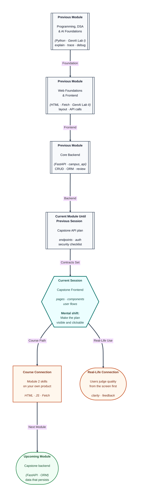

# Pre-read: Capstone Project I – Frontend Development

## Context of This Session in the Course

---

Users do not see your **ER diagram** on demo day. They see whether the **login screen** makes sense, whether buttons give **feedback**, and whether they can complete **one journey** without refreshing in panic. After planning APIs and security, the capstone moves to **frontend development**—the face of your product.

You studied **HTML**, **CSS**, **JavaScript**, **DOM** events, and **Fetch** in Module 2. You are not learning the web from zero; you are **applying** those skills to **your** capstone screens, guided by mentor checkpoints.

---

## Frontend as the story users touch

**What if** every page looks different because three teammates used three colour systems? **What if** forms have no loading state and users double-submit bookings? **What if** the UI calls endpoints that were **renamed** on the API plan?

**Frontend implementation** means building **pages and components** that match the agreed **user flows**: sign up, create resource, list, detail, optional AI assist panel. **UI integration** wires buttons to the **planned** fetch URLs and payloads—not imaginary ones.

**Client-side features** include validation you can do without the server (required fields, basic formats), toggling sections, and showing errors returned from the API in human language.

---

## Build against the contract, not against hope

Keep the **endpoint plan** visible while you code. When the backend is not ready, mock responses or use static JSON **with the same keys** the contract promises. That trick saves integration week.

Mentor **checkpoint reviews** focus on: Is the core journey clickable? Are fetch calls pointed at the right paths? Is the UI understandable to someone who did not build it?

---

## One analogy: the theatre rehearsal without the orchestra

In a **play rehearsal**, actors mark where the music will enter, even if the orchestra rehearses later. They follow the **script** (API contract) so opening night syncs.

Your frontend rehearsal builds sets and blocking. The backend orchestra joins soon—but the **script** stays fixed.

---

In this pre-read, you'll discover:

- How capstone **UI pages** map to planned user flows.
- How to connect **Fetch** calls to documented endpoints and payloads.
- Which **client-side** behaviours improve trust (loading, errors, disabled buttons).
- How mentor **milestones** keep scope honest before backend joins.
- How Module 2 skills transfer directly to a portfolio-grade screen.

---

## What's Next

After the session, you will be able to:

- Build **core capstone pages** aligned with your design docs.
- Implement **interactive** behaviour for at least one complete user path.
- Point network calls at **contract-correct** URLs and JSON shapes.
- Show a **frontend milestone** suitable for mentor review.
- Prepare hooks (buttons, forms) backend teammates can wire to real data.

---

## Think About These Before the Session

- Which screen will you demo if only **half** the app works—which journey is non-negotiable?
- How will you show **errors** when the API returns validation failure?
- What will you do on day one if the backend returns 404—fix the UI or fix the plan?
- Where might you **accidentally** put a secret while wiring an AI button—and what is the safer pattern?

Come with your **API plan** and **wireframe-level** intent. The session is about making the capstone **visible**, not perfect pixels.

---

## Accessibility and clarity without extra frameworks

You do not need a fancy component library to pass a professional milestone. **Consistent headings**, **visible focus** on buttons, and **plain-language labels** on forms already separate thoughtful work from rushed pages. If your capstone serves campus users on mobile data, avoid huge unoptimised images and prefer simple layouts you can explain in a demo.

When AI-assisted layout tools suggest markup, run the same **review habit** from earlier labs: check that IDs match your scripts, that forms do not submit twice, and that navigation links point to real files in your repo structure.
