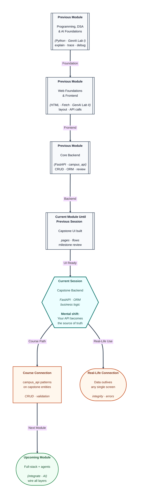

# Pre-read: Capstone Project II – Backend Development

## Context of This Session in the Course

---

The frontend **looks done**, but every list is still **hard-coded JSON** in a JavaScript file. Demo day approaches. Someone says, *“Let’s just fake the backend.”* Reviewers—and you—know the difference between theatre props and a working **server**.

This session is **Capstone backend development**: **FastAPI** routes, **ORM** models, **database** persistence, and **business logic** that make your UI truthful. It mirrors **campus_api** patterns at capstone scale, with mentor reviews on whether data **survives** a server restart.

---

## Backend as source of truth

**What if** two users book the last seat because the UI never checked availability on the server? **What if** passwords sit in a table as plain text? **What if** every route returns 200 even when SQL failed?

**Backend implementation** means each planned endpoint exists, validates input, talks to the database through **SQLAlchemy** (or your chosen ORM), and returns the **contract** JSON. **Server-side logic** encodes rules: capacity limits, ownership checks, soft deletes—things browsers must not be trusted to enforce alone.

**Database integration** maps your **schema** to models and migrations (or setup scripts appropriate to your scope). The nouns you designed—users, events, tickets—become rows teams can query.

---

## Milestone mindset

Mentors expect a **backend milestone**: create/read/update for core entities, auth hook if planned, and readable error responses. Fancy optimisations wait; **correctness** and **clarity** come first.

Pair with frontend teammates early: when list endpoints go live, swap mocks for real fetch results **one screen at a time**.

---

## One analogy: the bank ledger behind the ATM

The **ATM screen** is friendly. The **ledger** in the vault is authoritative. If the screen shows balance ₹500 but the ledger says ₹50, people lose trust instantly.

Your FastAPI + database layer is that ledger. The frontend is the ATM skin.

---

In this pre-read, you'll discover:

- How to implement **capstone endpoints** tied to your API plan.
- How **ORM models** express schema relationships in code.
- Where **business rules** must live (server, not only UI).
- How mentor **reviews** catch persistence and validation gaps.
- How this reuses **CRUD** confidence from earlier backend modules.

---

## What's Next

After the session, you will be able to:

- Stand up **core CRUD** APIs for capstone entities.
- Connect routes to a real **database** with ORM models.
- Encode at least one **non-trivial rule** server-side.
- Return **consistent** JSON matching your documented contracts.
- Pass a **backend milestone** review with evidence (screens + `/docs`).

---

## Think About These Before the Session

- Which endpoint, if broken, ruins the demo even if everything else shines?
- What is one rule the **browser must not** be allowed to decide alone?
- How will you test create/list without the frontend (Swagger, curl, HTTP client)?
- Where will **AI-related** routes call the model—and how do they reuse key management from earlier AI labs?

Treat the backend session as making your app **honest**. Integration week then connects wires instead of inventing truth.

---

## Errors, status codes, and `/docs` as your safety net

Professional APIs return **meaningful HTTP status codes**: 201 when something is created, 404 when an ID does not exist, 422 when validation fails. Your frontend teammates depend on those signals to show the right message. FastAPI’s automatic **OpenAPI** page is not just documentation—it is a **testing console** you can use before the UI is ready.

Log enough detail for yourself (which route, which ID failed) without leaking passwords or tokens in log lines. When you add an **AI route**, keep its failures separate from core CRUD: a model timeout should not delete a user’s saved data. Small habits like these signal maturity in mentor reviews and in interviews.
