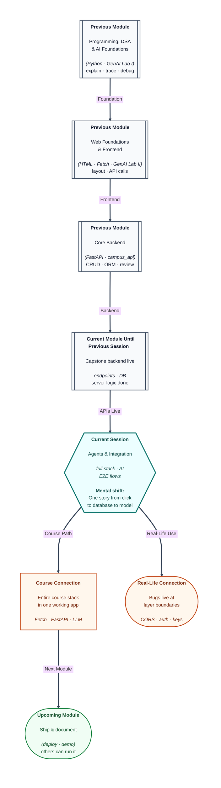

# Pre-read: Capstone Project III – Agents & Full-Stack Integration

## Context of This Session in the Course

---

Individually, your **pages**, **APIs**, and **AI helper** almost work. Together, a user clicks **Ask AI**, sees a spinner forever, and the console whispers **CORS error**—or the assistant confidently cites data that never came from your database. This is the **integration** session: **full-stack** wiring plus **AI agent** features in one **end-to-end** story.

You have practised layers separately. Now you prove they cooperate under real clicks.

---

## Full-stack integration: where bugs hide

**Full-stack integration** connects **frontend Fetch** calls to **live backend** URLs, handles **auth headers** or cookies if you planned them, and maps responses into the DOM. Failures often sit at **boundaries**:

- Wrong base URL between dev machines
- Missing `Authorization` header
- JSON key mismatch surviving from week one
- Server returning HTML error pages instead of JSON

**End-to-end workflows** mean one user story works from login (if in scope) through create/list/detail—and through the **AI** step if included—without manual database edits.

---

## AI agent features in the capstone

**AI agent integration** does not mean autonomous magic. In this course it means **applied AI** inside your product: a help panel, summariser, classifier, or search backed by **server-side** model calls and the **prompt patterns** you learned. Keys stay on the server; the UI sends only what the user intends to share.

Mentors help **troubleshoot integration**: reading network tabs, tracing which layer dropped the ball, fixing without rewriting the entire app.

---

## One analogy: the festival sound check

Before a **concert**, each instrument tests separately, then the band plays **one song together**. The awkward moment is always the **first joint sound check**—cables, mix levels, timing.

This session is that joint sound check for your capstone band: UI, API, DB, AI.

---

In this pre-read, you'll discover:

- How to **integrate** frontend and backend using your API contracts.
- Where **AI features** belong in the architecture you designed.
- What **end-to-end** means for mentor review and demo rehearsal.
- Common **integration defects** and how teams isolate them by layer.
- How to keep **scope** while fixing blockers on the critical path.

---

## What's Next

After the session, you will be able to:

- Run at least **one complete user flow** across UI, API, and database.
- Attach an **AI-powered** feature that respects server-side key rules.
- Use debugging habits (network trace, logs) on **cross-layer** bugs.
- Document known **limitations** honestly for demo day.
- Reach an **integration milestone** with mentor sign-off.

---

## Think About These Before the Session

- What is the **shortest** path through your app that proves “it works”—can you draw it in five boxes?
- If AI is down (rate limit, key typo), should the rest of the app still be usable?
- Which bug would you fix first: CORS, 401, or wrong JSON shape—and how do you tell them apart in the browser?
- What will you **not** demo because it is out of scope—practice saying that confidently.

Integration is messy for every team. Arrive expecting **one layer at a time** debugging, not shame when the first joint run fails.

---

## Environment parity and teamwork habits

**Environment parity** means dev machines agree on base URLs, ports, and `.env` variable **names** (not values). A README snippet listing `VITE_API_URL` vs `API_BASE` prevents silent mismatches. Use a shared chat or doc for “today’s blocker” so one teammate does not rewrite auth while another rewires CORS.

For **AI agent** flows, agree what context is sent per request—only the user’s question, or also a short excerpt from your database? More context can help answers but raises **privacy** questions mentors may ask in review. Decide deliberately and document it.
