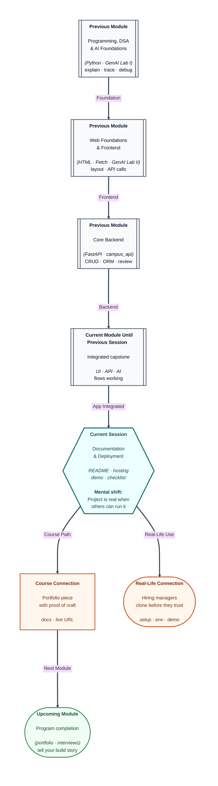

# Pre-read: Capstone Project IV – Documentation & Deployment

## Context of This Session in the Course

---

Your capstone **works on your laptop**—until a friend clones the repo and messages: *“Which Python version? Where do I put the key? What command starts the server?”* Ten minutes later they give up. For reviewers and employers, **software that only runs on your machine** is incomplete.

The final capstone chapter is **documentation** and **deployment**: README and setup guides, API docs, hosting the frontend and backend so others can **try** your work, plus **demo** and **submission** preparation. You are closing the loop from idea to **shareable** product.

---

## Documentation as respect for the reader

**Documentation** includes:

- **README** with problem statement, stack, setup steps, and how to run
- **API documentation** (often Swagger from FastAPI, plus notes on auth)
- **Environment variable** list without real secret values
- **Demo script**—what you will click and say in five minutes

**What if** your README says `npm start` but the project uses plain HTML? **What if** reviewers cannot find where AI keys belong? Docs are **kindness** and **professionalism**.

---

## Deployment: making it real on the internet

**Deployment** means choosing a **hosting** approach appropriate to class: static frontend on a static host, backend on a PaaS, database managed or containerised per mentor guidance. Goals are not hyperscale—they are **reachable URLs**, **HTTPS** where possible, and a **repeatable** deploy path.

You will discuss **final review**: submission checklist, known bugs listed honestly, and how to take **mentor feedback** without panic refactors.

---

## Demo preparation

A strong **demo** tells a **user story**, not a tour of every file. Show the problem, the happy path, one AI moment if in scope, and what you would build next. Practice recovering if Wi-Fi drops—screenshots or a short backup video are acceptable insurance.

---

## One analogy: the recipe card on the masala tin

A great **homemade masala** still needs a **recipe card** so family can recreate it. Your code is the masala; docs and deploy are the card and the shared kitchen instructions.

---

In this pre-read, you'll discover:

- Which **documentation artefacts** capstone submission expects.
- How **deployment** differs from “it runs on localhost.”
- What belongs in a **demo** vs what to cut for time.
- How **mentor final review** shapes last-week priorities.
- How this completes the **course arc** from first Python print to shipped story.

---

## What's Next

After the session, you will be able to:

- Write a **README** and setup guide another student can follow.
- Point reviewers to **live** or **hosted** demo endpoints where required.
- Prepare **submission materials** per the checklist.
- Deliver a **focused demo** of your capstone value.
- Mark the **capstone delivery milestone** complete with pride and clarity.

---

## Think About These Before the Session

- Could **you** set up your project on a fresh laptop using only your README? What step is missing?
- What is one **known bug** you will disclose instead of hiding during demo?
- If deploy fails hour before submission, what is your **minimum viable** fallback (video, screenshots)?
- How will you explain **your design choices** in two minutes to a non-technical relative?

This is the session where your work becomes **evidence** of what you learned—not a folder only you understand. Finish strong, document kindly, and ship something you are willing to show on a resume.

---

## Portfolio framing after the course

When you update your resume or LinkedIn, lead with **problem → your stack → outcome**, not a laundry list of buzzwords. A live link plus a crisp README often beats a zip file. Be ready to walk through **one design trade-off** you made (why this schema, why server-side AI) and **one thing you would improve** with more time—interviewers trust that honesty.

Celebrate that you moved from first **print** statements to a documented, deployable capstone. That arc is the story this certification is meant to tell.
